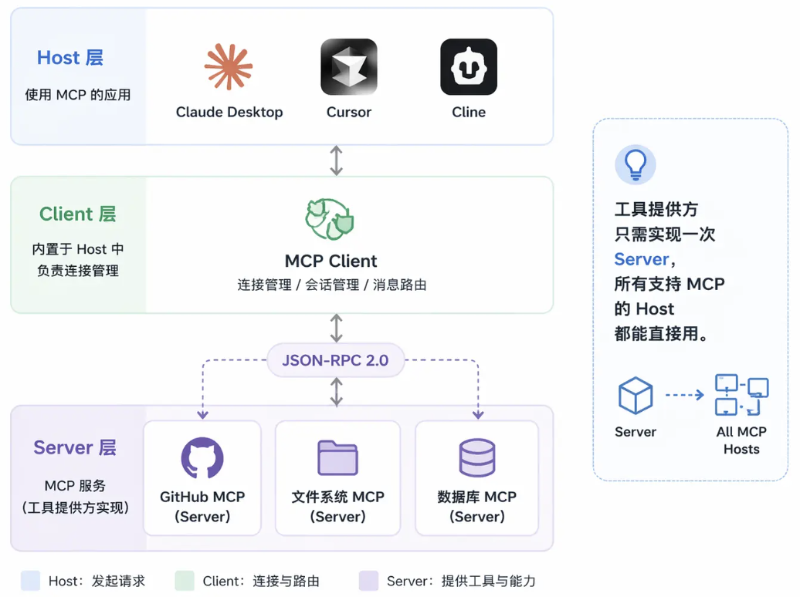
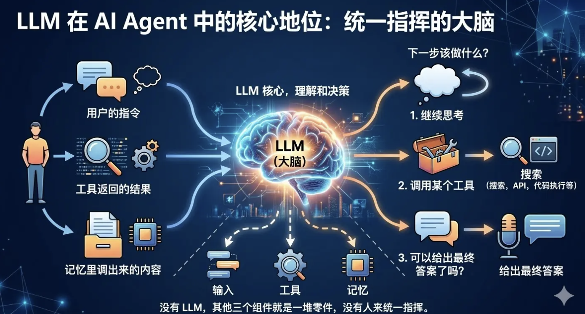
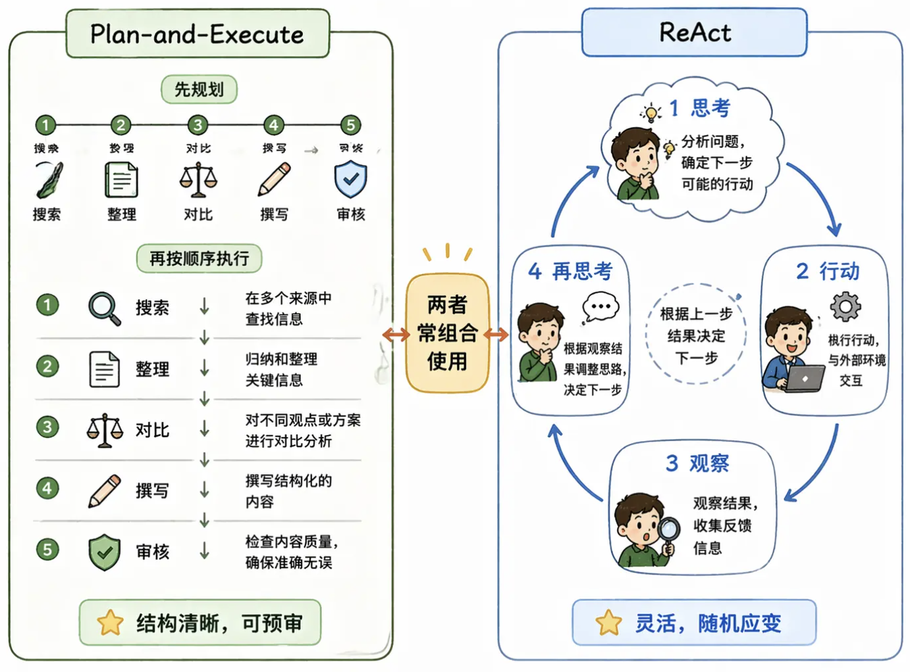
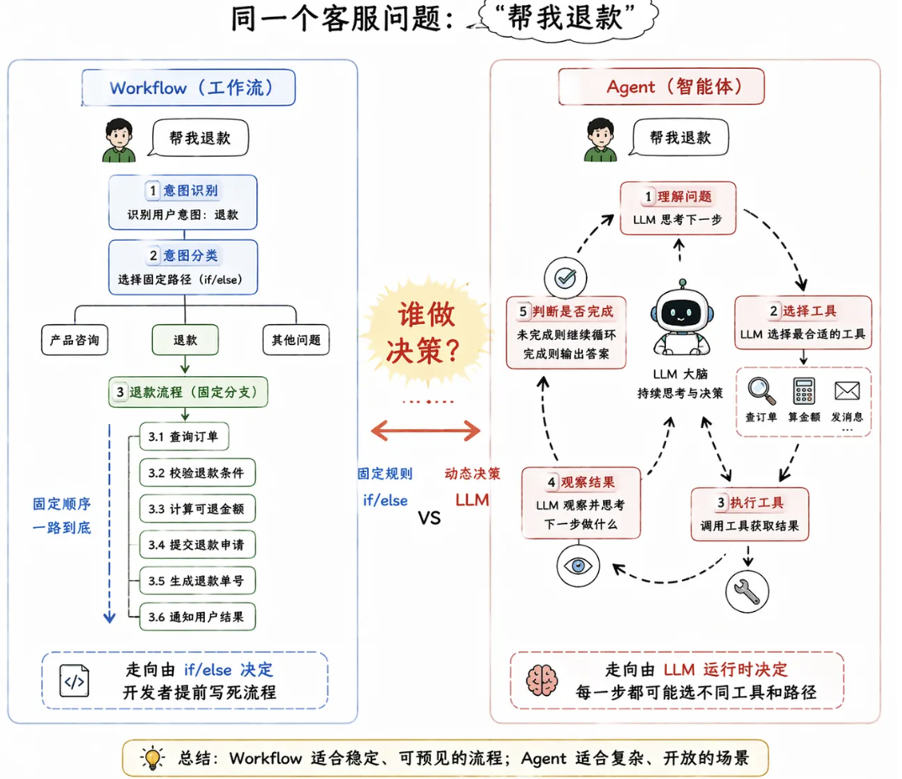
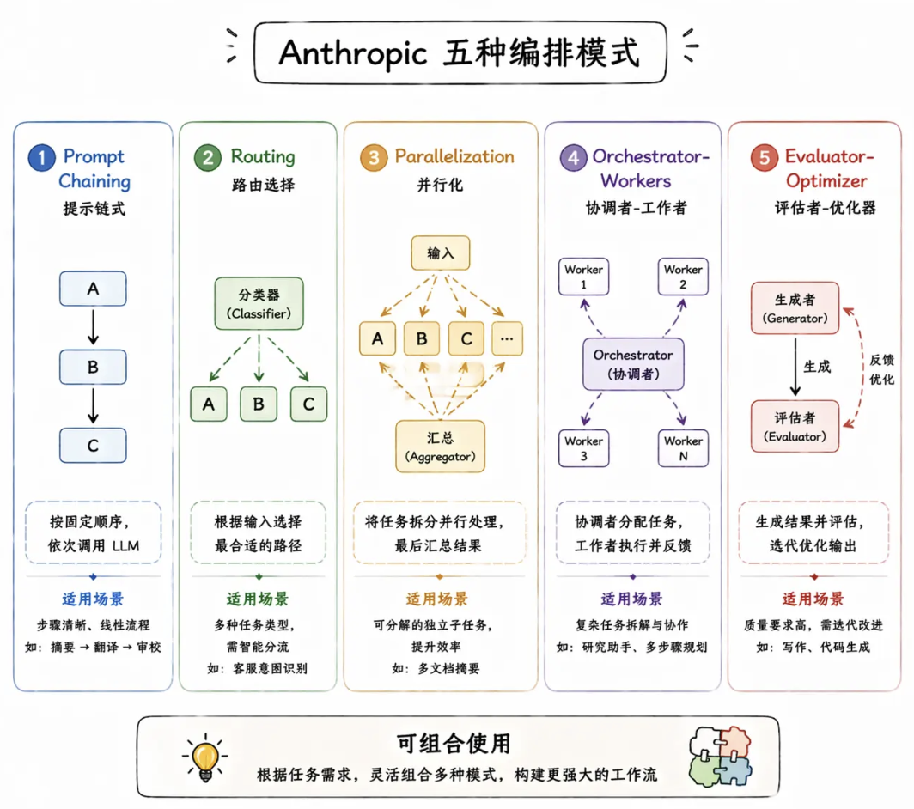

# Agent

## 1. 从普通大模型到 Agent

### 1.1 普通大模型的局限

- **知识被冻结**：模型的训练数据有截止时期，无法获取实时信息。
- **不能行动**：本质是文本生成器，无法执行任何行动。
- **没有持续状态**：每次调用之间是失忆的。

### 1.2 Agent 是什么？

**能自主完成目标的 AI 系统。**

运作闭环（与传统的核心区别）：**感知 → 规划 → 行动 → 再感知**。

### 1.3 三大核心能力

#### 1.3.1 工具调用

调用外部工具，比如搜索引擎、代码执行器、数据库、API。

> **注意**：模型不是自己执行，是模型告诉代码去执行，结果再反馈给模型。

#### 1.3.2 记忆机制

**短期记忆 + 长期记忆。**

| 类型 | 内容 |
| :--- | :--- |
| **短期记忆** | 当前任务执行过程中的中间状态 |
| **长期记忆** | 跨任务的信息，比如用户偏好、历史操作记录 |

长期记忆用向量数据库存储，需要的时候做语义检索拿回来。

#### 1.3.3 多步推理和自我纠错

执行过程中能**感知失败、分析原因、换一种方式重试**，还有边做边反思。

## 2. 为什么 Agent 现在才爆发？

### 2.1 大模型的能力提升

从 GPT-4、Claude 3 这一代开始，能读懂复杂指令并作出合理的多步决策了。

### 2.2 工具调用的标准化

OpenAI 推出了 **Function Calling** 机制，让模型能以结构化的 JSON 格式输出工具调用请求，有了统一的工具调用协议。

### 2.3 配套生态的完善

LangChain、LlamaIndex 这些框架把 Agent 的开发门槛大幅降低了。

## 3. 标准协议

### 3.1 MCP（模型上下文协议）

**Anthropic 提出，解决工具调用问题。**

定义一套标准的 **JSON-RPC 协议**，工具提供方只要按这个标准暴露自己的能力，任何支持 MCP 的 Agent 都能直接发现和调用这些工具，不用额外写适配代码。

### 3.2 A2A（Agent 间通信协议）

**解决 Agent 怎么和另一个 Agent 协作的问题。**

每个 Agent 都有一个名片，写明能做什么、正在做什么、需要什么输入。

## 4. 四个核心组件

### 4.1 LLM

#### 4.1.1 System Prompt

定义好 Agent 的**角色、行为边界、输出格式要求**等。

例：

> 你是一个专业的客服助手，只回答产品相关问题，遇到不确定的信息要说不知道，不要编造答案。

#### 4.1.2 选哪个模型？

- **推理能力**：专门为推理优化的模型越来越多，比如 OpenAI 的 o1/o3 系列、DeepSeek-R1 这类推理模型（Reasoning Model），在做复杂任务拆解和多步决策时表现会更好。代价是延迟更高、Token 消耗更大，所以不是所有场景都适合用。
- **工具调用的稳定性**：有些模型生成的 JSON 格式经常出错、参数乱填，导致工具调用失败。
- **上下文窗口大小**：Agent 每一步的工具返回结果都要塞进上下文，如果模型的窗口太小，后面的步骤就看不到前面发生了什么。

一个常见的工程做法：

| 任务 | 模型选择 |
| :--- | :--- |
| **复杂思考** | 推理模型 |
| **主循环处理** | 通用大模型 |
| **轻量任务** | 小模型 |

### 4.2 工具系统

模型根据你给出的 **`description`** 来判断什么时候该用这个工具。

**工具描述的质量直接影响 Agent 的表现。**

### 4.3 记忆系统

#### 4.3.1 长期记忆的组织方式

| 类型 | 存什么 | 例子 |
| :--- | :--- | :--- |
| **语义记忆** | 事实性知识 | 用户是做金融行业的 |
| **情景记忆** | 具体的经历 | 上次用户问退款问题时，我们查了订单系统，发现他的订单已过退款期 |
| **程序性记忆** | “怎么做事”的经验 | 处理退款问题的标准流程是先查订单状态，再核实支付方式 |

**程序性记忆不是存某个具体的事实，而是把 Agent 做事的方法论沉淀下来。**

#### 4.3.2 问题与解决方法

| 类型 | 问题 | 解决方法 |
| :--- | :--- | :--- |
| **短期记忆** | 上下文窗口有限，每步工具返回大量文本，上下文很快就满了 | 摘要压缩 / 滑动窗口 |
| **长期记忆** | 什么该存、什么不该存；数据库有噪音，干扰模型决策 | 存入前做一轮重要性评估 / 记忆衰减 |

**记忆衰减**：给每条记忆加一个时间权重，越久远的记忆权重越低，检索的时候自然就排在后面。

### 4.4 规划模块

#### 4.4.1 规划方式

| 方式 | 做法 |
| :--- | :--- |
| **Plan-and-Execute** | 先规划再执行 |
| **ReAct** | 边执行边规划 |

**结合使用**：先做一个粗略的计划确定大方向，执行过程中再根据反馈动态微调。

#### 4.4.2 提升推理能力的技术

- **CoT（思维链）**：把思考过程写出来。每一步推理的输出会成为下一步推理的输入，把中间步骤写出来，等于给了模型更多的思考空间。
- **ToT（思维树）**：在每个推理节点上展开多个可能的分支，然后评估每个分支的质量，选出最优的路径继续往下走。

### 4.5 总结

> **规划 → 决策 → 执行 → 记忆 → 再决策。**

## 5. Workflow、Agent、Tool

### 5.1 Tools：最小的能力积木

按特定格式暴露给 Agent 的函数：**普通函数是给程序员调用的，Tool 是给 LLM 调用的。**

包装 **Schema（名字、描述、参数类型）**，和普通函数的唯一区别：需要额外写一份说明书。

#### 5.1.1 设计原则

- **职责单一**。
- **描述要精确**。
- **错误信息要清晰**：工具执行失败时，返回给 LLM 的错误信息必须是它能看懂的。
- **参数设计要简洁**：填的参数越多，出错的概率就越大。

### 5.2 Agent

#### 5.2.1 停止机制

- 主动判断任务完成。
- 设置最大循环次数。
- 设置 Token 预算上限。
- 超时机制。

#### 5.2.2 行为不确定

同样的任务，可能调了不同的工具、走了不同的路径，甚至得到微妙不同的结果。

### 5.3 Workflow

把整个执行流程的**骨架写在代码里**，LLM、Agent、Tools 都只是这个流程里的节点。

整体走哪条路、下一步去哪里，全由开发者的代码决定，不是任何节点自己说了算。

> **最核心的区别：谁在做下一步的决策？** Agent 是 LLM 自己决定，Workflow 是开发者写死在代码里。

### 5.4 Agentic Workflow

用 **Workflow 固定主流程的骨架**，在需要灵活判断的节点嵌入 **Agent**，其余固定节点直接用 **LLM 或 Tools**。

### 5.5 Workflow 编排模式

| 模式 | 做法 |
| :--- | :--- |
| **Prompt Chaining（提示链）** | 把一个大任务拆成多个小步骤，前一步的输出作为后一步的输入，像流水线一样串起来 |
| **Routing（路由）** | 先用一个 LLM 做分类判断，然后根据分类结果把请求分发到不同的处理分支 |
| **Parallelization（并行化）** | 把可以同时进行的子任务并行执行，最后汇总结果，用于需要多维度分析的场景 |
| **Orchestrator-Workers（编排者-工人）** | 一个中央编排者负责分配任务，多个 Worker 各自完成子任务 |
| **Evaluator-Optimizer（评估者-优化者）** | 一个 LLM 负责生成输出，另一个 LLM（或者同一个模型换一个角色）负责评估这个输出的质量 |

