# Agent

## 1. 从普通大模型到 Agent

### 1.1 普通大模型的局限

- **知识被冻结**：模型的训练数据有截止时期，无法获取实时信息。
- **不能行动**：本质是文本生成器，无法执行任何行动。
- **没有持续状态**：每次调用之间是失忆的。

### 1.2 Agent 是什么？

**能自主完成目标的 AI 系统。**

运作闭环（与传统的核心区别）：**感知 → 规划 → 行动 → 再感知**。

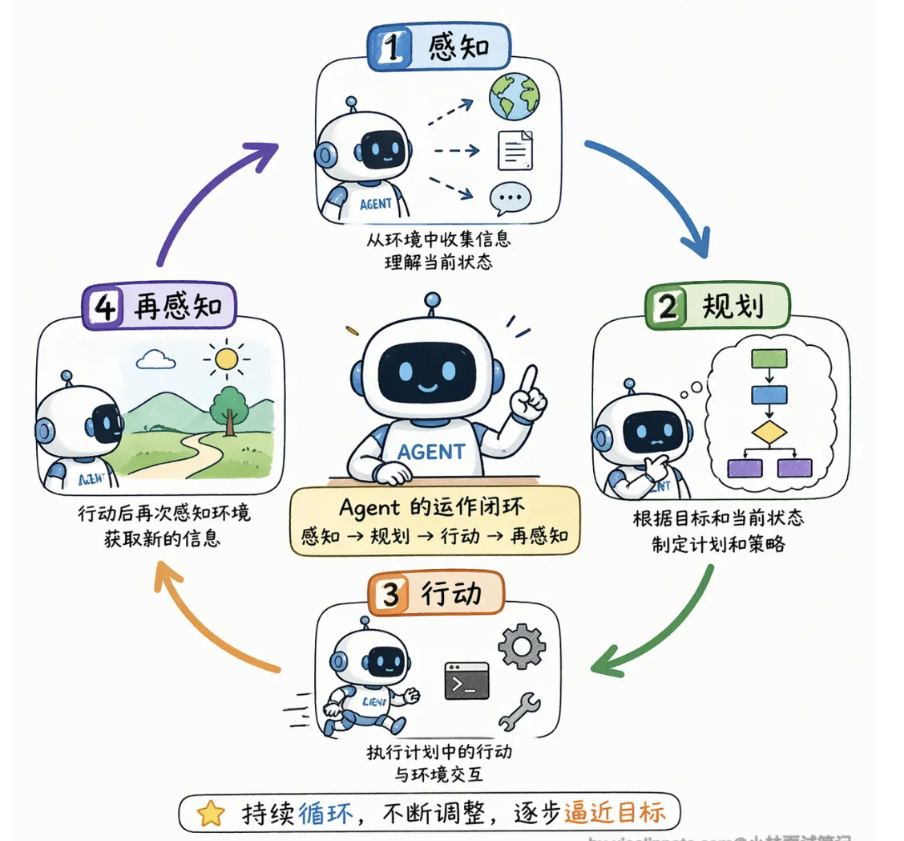

### 1.3 三大核心能力

#### 1.3.1 工具调用

调用外部工具，比如搜索引擎、代码执行器、数据库、API。

> **注意**：模型不是自己执行，是模型告诉代码去执行，结果再反馈给模型。

#### 1.3.2 记忆机制

**短期记忆 + 长期记忆。**

| 类型 | 内容 |
| :--- | :--- |
| **短期记忆** | 当前任务执行过程中的中间状态 |
| **长期记忆** | 跨任务的信息，比如用户偏好、历史操作记录 |

长期记忆用向量数据库存储，需要的时候做语义检索拿回来。

#### 1.3.3 多步推理和自我纠错

执行过程中能**感知失败、分析原因、换一种方式重试**，还有边做边反思。

## 2. 为什么 Agent 现在才爆发？

### 2.1 大模型的能力提升

从 GPT-4、Claude 3 这一代开始，能读懂复杂指令并作出合理的多步决策了。

### 2.2 工具调用的标准化

OpenAI 推出了 **Function Calling** 机制，让模型能以结构化的 JSON 格式输出工具调用请求，有了统一的工具调用协议。

### 2.3 配套生态的完善

LangChain、LlamaIndex 这些框架把 Agent 的开发门槛大幅降低了。

## 3. 标准协议

### 3.1 MCP（模型上下文协议）

**Anthropic 提出，解决工具调用问题。**

定义一套标准的 **JSON-RPC 协议**，工具提供方只要按这个标准暴露自己的能力，任何支持 MCP 的 Agent 都能直接发现和调用这些工具，不用额外写适配代码。

### 3.2 A2A（Agent 间通信协议）

**解决 Agent 怎么和另一个 Agent 协作的问题。**

每个 Agent 都有一个名片，写明能做什么、正在做什么、需要什么输入。

## 4. 四个核心组件

### 4.1 LLM

#### 4.1.1 System Prompt

定义好 Agent 的**角色、行为边界、输出格式要求**等。

例：

> 你是一个专业的客服助手，只回答产品相关问题，遇到不确定的信息要说不知道，不要编造答案。

#### 4.1.2 选哪个模型？

- **推理能力**：专门为推理优化的模型越来越多，比如 OpenAI 的 o1/o3 系列、DeepSeek-R1 这类推理模型（Reasoning Model），在做复杂任务拆解和多步决策时表现会更好。代价是延迟更高、Token 消耗更大，所以不是所有场景都适合用。
- **工具调用的稳定性**：有些模型生成的 JSON 格式经常出错、参数乱填，导致工具调用失败。
- **上下文窗口大小**：Agent 每一步的工具返回结果都要塞进上下文，如果模型的窗口太小，后面的步骤就看不到前面发生了什么。

一个常见的工程做法：

| 任务 | 模型选择 |
| :--- | :--- |
| **复杂思考** | 推理模型 |
| **主循环处理** | 通用大模型 |
| **轻量任务** | 小模型 |

### 4.2 工具系统

模型根据你给出的 **`description`** 来判断什么时候该用这个工具。

**工具描述的质量直接影响 Agent 的表现。**

### 4.3 记忆系统

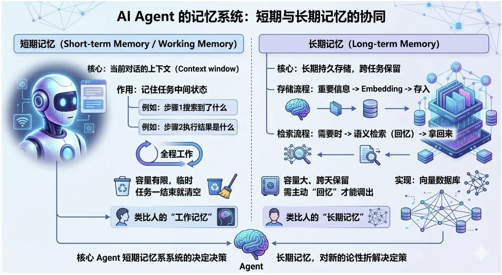

#### 4.3.1 长期记忆的组织方式

| 类型 | 存什么 | 例子 |
| :--- | :--- | :--- |
| **语义记忆** | 事实性知识 | 用户是做金融行业的 |
| **情景记忆** | 具体的经历 | 上次用户问退款问题时，我们查了订单系统，发现他的订单已过退款期 |
| **程序性记忆** | “怎么做事”的经验 | 处理退款问题的标准流程是先查订单状态，再核实支付方式 |

**程序性记忆不是存某个具体的事实，而是把 Agent 做事的方法论沉淀下来。**

#### 4.3.2 问题与解决方法

| 类型 | 问题 | 解决方法 |
| :--- | :--- | :--- |
| **短期记忆** | 上下文窗口有限，每步工具返回大量文本，上下文很快就满了 | 摘要压缩 / 滑动窗口 |
| **长期记忆** | 什么该存、什么不该存；数据库有噪音，干扰模型决策 | 存入前做一轮重要性评估 / 记忆衰减 |

**记忆衰减**：给每条记忆加一个时间权重，越久远的记忆权重越低，检索的时候自然就排在后面。

### 4.4 规划模块

#### 4.4.1 规划方式

| 方式 | 做法 |
| :--- | :--- |
| **Plan-and-Execute** | 先规划再执行 |
| **ReAct** | 边执行边规划 |

**结合使用**：先做一个粗略的计划确定大方向，执行过程中再根据反馈动态微调。

#### 4.4.2 提升推理能力的技术

- **CoT（思维链）**：把思考过程写出来。每一步推理的输出会成为下一步推理的输入，把中间步骤写出来，等于给了模型更多的思考空间。
- **ToT（思维树）**：在每个推理节点上展开多个可能的分支，然后评估每个分支的质量，选出最优的路径继续往下走。

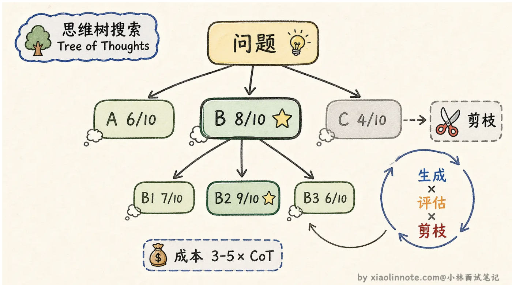

- **GoT（思维图）**：允许不同路径的中间结果合并、复用，也就是说一个推理节点可以接收来自多个前置节点的输出作为输入。

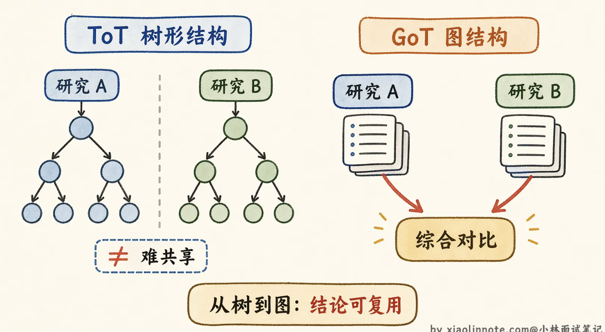

**总结：**

- **CoT**：用得最多，因为实现成本最低，就是改个 Prompt。
- **ToT**：效果更好，但调用次数多，成本大概是 3 到 5 倍。
- **GoT**：目前还比较学术，生产环境没见过有人真正落地用的。

### 4.5 总结

> **规划 → 决策 → 执行 → 记忆 → 再决策。**

## 5. Workflow、Agent、Tool

### 5.1 Tools：最小的能力积木

按特定格式暴露给 Agent 的函数：**普通函数是给程序员调用的，Tool 是给 LLM 调用的。**

包装 **Schema（名字、描述、参数类型）**，和普通函数的唯一区别：需要额外写一份说明书。

#### 5.1.1 设计原则

- **职责单一**。
- **描述要精确**。
- **错误信息要清晰**：工具执行失败时，返回给 LLM 的错误信息必须是它能看懂的。
- **参数设计要简洁**：填的参数越多，出错的概率就越大。

### 5.2 Agent

#### 5.2.1 停止机制

- 主动判断任务完成。
- 设置最大循环次数。
- 设置 Token 预算上限。
- 超时机制。

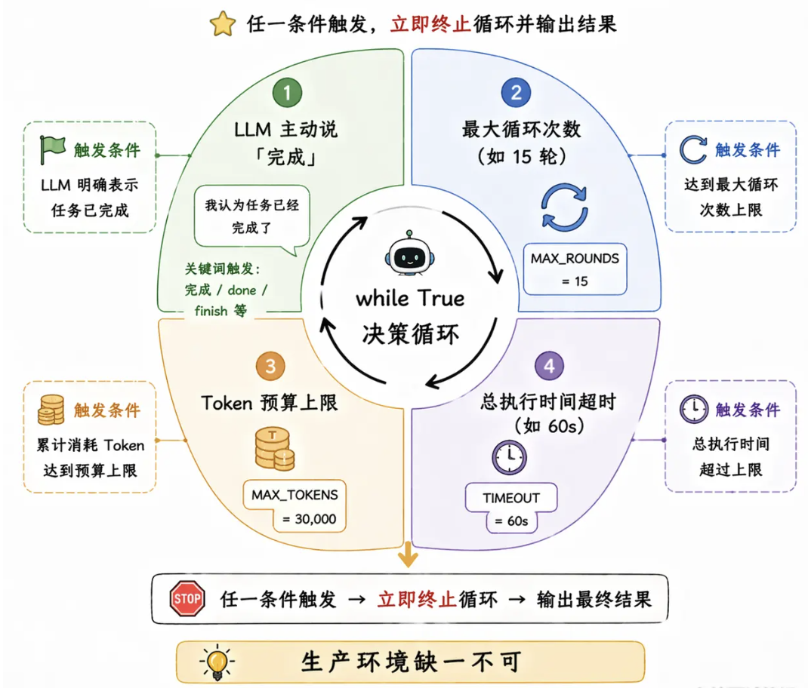

#### 5.2.2 行为不确定

同样的任务，可能调了不同的工具、走了不同的路径，甚至得到微妙不同的结果。

### 5.3 Workflow

把整个执行流程的**骨架写在代码里**，LLM、Agent、Tools 都只是这个流程里的节点。

整体走哪条路、下一步去哪里，全由开发者的代码决定，不是任何节点自己说了算。

> **最核心的区别：谁在做下一步的决策？** Agent 是 LLM 自己决定，Workflow 是开发者写死在代码里。

### 5.4 Agentic Workflow

用 **Workflow 固定主流程的骨架**，在需要灵活判断的节点嵌入 **Agent**，其余固定节点直接用 **LLM 或 Tools**。

### 5.5 Workflow 编排模式

| 模式 | 做法 |
| :--- | :--- |
| **Prompt Chaining（提示链）** | 把一个大任务拆成多个小步骤，前一步的输出作为后一步的输入，像流水线一样串起来 |
| **Routing（路由）** | 先用一个 LLM 做分类判断，然后根据分类结果把请求分发到不同的处理分支 |
| **Parallelization（并行化）** | 把可以同时进行的子任务并行执行，最后汇总结果，用于需要多维度分析的场景 |
| **Orchestrator-Workers（编排者-工人）** | 一个中央编排者负责分配任务，多个 Worker 各自完成子任务 |
| **Evaluator-Optimizer（评估者-优化者）** | 一个 LLM 负责生成输出，另一个 LLM（或者同一个模型换一个角色）负责评估这个输出的质量 |

## 6. Agent 的设计范式

### 6.1 ReAct

每一轮循环由三个步骤组成：

> **Thought → Action → Observation**

**Thought 阶段**：LLM 先把当前的情况分析一遍，把推理过程写出来。Thought 的内容是可见的。

这个循环会不断重复，直到 LLM 在某轮 Thought 中判断“信息已经够了，可以给出最终答案”。

**问题**：每一步都是局部最优，处理复杂任务容易迷失方向。

### 6.2 Plan-and-Execute

一个 LLM 专门做规划，输出一个**完整的步骤列表**，然后由另一个 LLM（或同一个模型以不同角色）逐步执行。

**关键机制：动态重规划。** 每执行完一步都会把结果反馈给规划器，如果偏离，规划器会修改后续的步骤，甚至插入新的步骤来应对。

### 6.3 Reflection

在前两种范式的基础上加了一层**“质量保障”**。

Agent 完成一步或者完成整个任务之后，再让一个 LLM（可以是同一个模型，也可以是专门的评估模型）来判断做得好不好、结果是否符合预期。

#### 6.3.1 变体：Reflexion

生成一段具体的**“反思总结”**，记录下这次失败的原因和改进建议，然后把这段总结作为额外的上下文传给下一次尝试。

### 6.4 三种范式怎么选？

根据**任务复杂度和质量要求**选择：

| 情况 | 选择 |
| :--- | :--- |
| 任务步骤不多，每步都比较独立 | **ReAct**，简单直接 |
| 任务很复杂，步骤之间有依赖关系，需要全局统筹 | **Plan-and-Execute** |
| 对输出质量要求特别高，允许多花一些时间和成本 | 在前面的基础上叠加 **Reflection** |

**实际混合使用：**

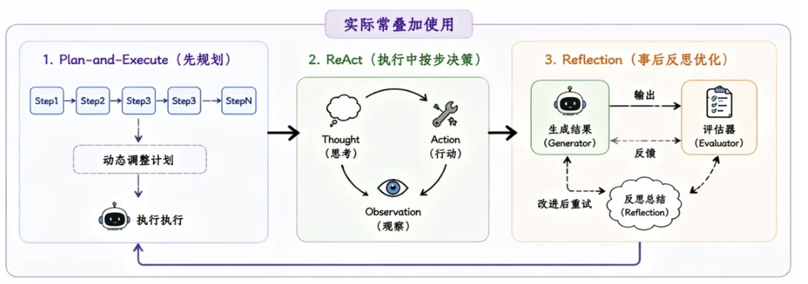

## 7. 推理模式

通过不同的方式，让 LLM 把隐式的思考过程显化出来，从而减少多步推理中的累积误差。

### 7.1 CoT

在 Prompt 里加一句**“让我们一步步思考”**，LLM 就会先把推理步骤写出来，再给答案。

因为先写出来的推理内容会进入上下文，成为后续生成的依据。

#### 7.1.1 两种触发方式

| 方式 | 做法 | 特点 |
| :--- | :--- | :--- |
| **Zero-shot CoT** | 直接在 Prompt 末尾加上“让我们一步步思考” | 优势是零成本、即插即用；缺点是 LLM 的推理格式和深度完全靠它自己发挥，不太稳定 |
| **Few-shot CoT** | 在 Prompt 里给几个带有完整推理过程的例子 | 让 LLM 照着这个格式来模仿 |

#### 7.1.2 根本性局限

**是纯文字推理，没有办法和外部世界交互。**

### 7.2 Act-only

让 LLM **直接输出工具调用序列，不写任何思考过程**。

看起来效率很高，但每一步行动之间没有推理链条来连接，无法灵活调整策略。

### 7.3 ReAct

在 CoT 的推理链里，插入真实的行动：**推理为行动提供方向，行动为推理提供事实。**

通过 Prompt 格式约束 LLM 的输出结构：

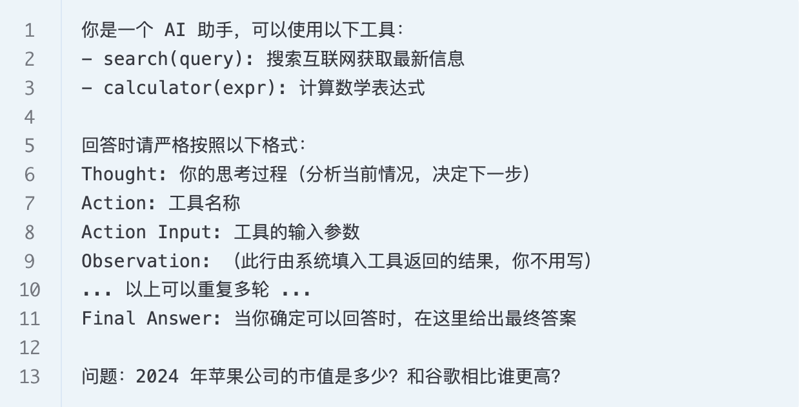

整个 Loop 里，真正的智能全在 LLM 每次输出的 Thought 里，**所有循环和控制逻辑都由代码框架完成**。

### 7.4 Function Calling

现代 LLM（GPT-4、Claude 3 之后）基本都原生支持 Function Calling，模型可以直接输出**结构化的 JSON 工具调用**，不再需要靠解析 `Action: xxx` 这种文本格式。

只是 **Action 这一步从解析文本变成了解析结构化 JSON**。

### 7.5 ReAct 的问题

- **循环漂移**：局部最优问题。
- **错误传播**：如果中间某一步拿到了错误的信息，或者工具返回了一个有误的结果，后面所有的推理都会跑偏。

## 8. 任务拆分

### 8.1 为什么需要任务拆分？

Context window 有大小限制，能同时处理的信息量有上限。任务越大，中间状态越多越乱，LLM 很难持续追踪“我现在在做哪个子目标”。

> **注意力集中 = 准确率提升。**

### 8.2 静态拆分

提前把任务流程设计好，固定成一个确定的 **Workflow，由人决定**。

### 8.3 动态拆分

**由模型决定**，根据任务实时生成步骤，是 **Plan-and-Execute** 模式的核心思想。

- 拆分之后要分析步骤之间的**依赖关系**。
- 有些步骤之间没有依赖，可以同时进行，降低总耗时。
- 拆分的粒度以**原子操作**为标准。

### 8.4 自适应拆分

**先试，做不好就再拆。**

先让执行器尝试完成当前任务：

- **做得好**：继续往下走，不做多余的拆分。
- **明显做不好**：比如超过最大步数还没完成，或者输出质量不达标，就把这个任务交给规划器，进一步拆成更小的子任务。

计算开销和任务的实际难度成正比：**任务越复杂，递归拆分的层数就越深；任务越简单，可能一层都不拆。**

### 8.5 Replan 机制

把**当前步骤的结果和剩余的计划**一起交给规划模块，让它判断：

> 基于当前的新信息，后面的计划还合理吗？

### 8.6 拆分结果的验证

| 标准 | 验证内容 |
| :--- | :--- |
| **完备性** | 所有步骤加在一起，能覆盖原始任务的全部要求，没有遗漏 |
| **独立性** | 每个步骤的职责边界清晰，没有重叠 |
| **可验证性** | 每个步骤执行完之后，能不能用一个简单的标准判断它做对了没有 |

## 9. 记忆机制

### 9.1 四种记忆类型

- **感知记忆**：当前这次调用的原始输入。生命周期只有一次调用，处理完就消失，不会主动保留。
- **短期记忆**。**进阶：结构化工作记忆**，给这个“工作台”划出几个固定区域，放不同内容。每一步执行完，Agent 主动更新对应区域内容。
- **长期记忆**。
- **实体记忆**：把对话中出现的关键实体和事实主动提取出来，存成结构化字段，比如“用户偏好 Python”“客户预算是 5 万”“项目截止日是 3 月底”。存的是**提炼出来的结论，而不是原始对话本身**。

### 9.2 存什么？

> **判断标准**：这条信息，下次任务开始时如果知道，会让 Agent 做得更好吗？

通常值得存的有三类：

- **用户偏好和习惯**。
- **任务执行中产生的关键结论和决策**。
- **外部知识**：产品文档、FAQ、历史案例。

### 9.3 怎么存？

| 信息 | 存储与查询方式 |
| :--- | :--- |
| **结构化的偏好字段** | 用关系数据库精确查 |
| **非结构化的知识和历史** | 用向量数据库语义检索 |

#### 9.3.1 存储粒度

- **粒度太细**：LLM 拿到的是不完整的偏好信息。
- **粒度太粗**：无关信息太多。

按**“一次完整交互”**或**“一个独立的知识点 / 事件”**来存：

| 存储单位 | 做法与特点 |
| :--- | :--- |
| **一次完整交互** | 用户的一个具体请求加上 Agent 处理结果，信息完整性好 |
| **一个独立的知识点 / 事件** | 把“用户偏好：Python，简洁风格，英文注释”打包成一条结构化记录，检索时一次拿到完整偏好，不会碎片化 |

### 9.4 什么时候取出来？

| 方式 | 时机与做法 |
| :--- | :--- |
| **主动检索** | 任务开始前，用当前任务的描述去检索相关记忆，把结果注入 System Prompt 作为背景知识 |
| **被动触发** | Agent 在推理过程中，判断当前步骤需要某类特定知识时，主动发起检索 |

### 9.5 Context Window：短期记忆的工作台不够大怎么办？

- **滑动窗口**：只保留最近 N 轮对话，更早的历史直接丢弃。
- **摘要压缩**：用 LLM 把早期的对话历史压缩成一段摘要，替换掉原始的冗长历史。
- 把**不常用但重要的信息“卸载”到长期记忆**里。

### 9.6 知识图谱

用 **“实体 → 关系 → 实体”** 的三元组结构来存储信息。实体和实体之间通过明确的关系连接起来，形成一张网状的知识网络。

查询时可以沿着关系链条做**多跳推理**。

**向量数据库和知识图谱两者互补：**

1. 对话过程中，用 LLM 自动提取出实体和关系，存入知识图谱。
2. 检索时，先用向量检索拿到一批候选记忆。
3. 再用知识图谱补充关联信息。
4. 最后把两部分结果合并后注入 Context。

### 9.7 记忆整合

定期对长期记忆做**清理和升华**：

- **去重**。
- **冲突消解**。
- **抽象提炼**：把情景记忆转换成语义记忆。

### 9.8 完整的配合方式

#### 9.8.1 任务开始前：先读记忆

1. 从实体记忆里取出用户的结构化偏好（语言偏好、风格要求、过往决策）。
2. 用任务描述作为查询词，去长期记忆里做一次语义检索，拿回最相关的历史背景。
3. 把这两部分信息拼进 System Prompt 的开头。

#### 9.8.2 执行任务中：持续用记忆

短期记忆全程工作，用户的每一条消息、模型的每一次输出、工具调用返回的每一个结果，都追加进 `messages`。

如果某个执行步骤需要特定的专业知识，Agent 可以临时发起一次长期记忆检索，**用完即走，不需要永久保留在 `messages` 中**。

#### 9.8.3 任务结束后：主动写记忆

- 如果用户在对话中表达了新的偏好，就更新实体记忆的对应字段。
- 如果任务产生了有价值的结论，就把这条摘要写入长期记忆。
- 最后清空短期记忆（`messages` 列表）。

## 10. 多智能体系统

### 10.1 单 Agent 的限制

- **Context 窗口大小**：复杂任务信息量一多就撑爆了。
- **单点能力**：什么都让一个 Agent 做，每件事都是泛才。

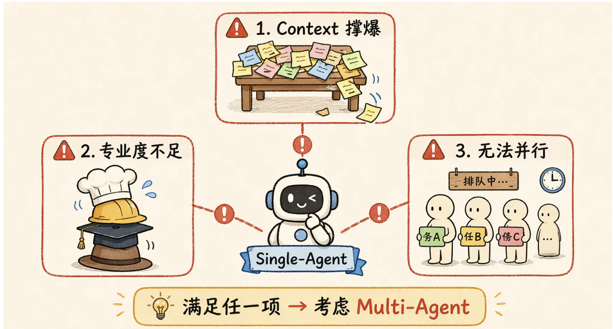

### 10.2 Multi-Agent：专业分工、并行执行

#### 10.2.1 协作方式

| 模式 | 做法 |
| :--- | :--- |
| **顺序流水线** | Agent A 做完把结果交给 Agent B，B 做完交给 Agent C |
| **并行扇出** | 一个调度者把多个独立子任务同时分发给不同的 Worker Agent，各自并行执行，最后由调度者收集汇总 |
| **辩论 / 评审模式** | 多个 Agent 对同一个问题各自给出方案，再由裁判 Agent 或者它们互相评审，筛选最优解 |

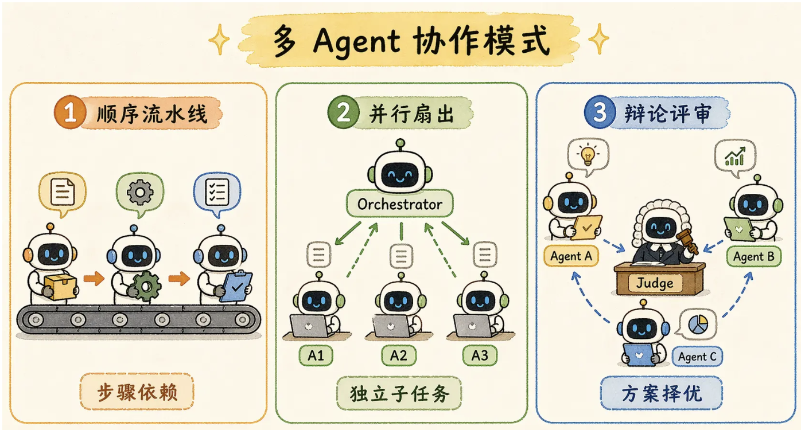

### 10.3 Multi-Agent 系统的组织方式

#### 10.3.1 中心化

由一个统一的调度者 **Orchestrator** 来分配任务、收集结果。

**Orchestrator 负责三件事：**

1. 读懂用户的大目标，把它拆成一个个子任务。
2. 判断每个子任务该交给哪个 Worker Agent 去做。
3. 收集每个 Worker 的产出，把它们拼成最终答案。

**Orchestrator 的变体：**

| 变体 | 做法 |
| :--- | :--- |
| **静态路由** | 任务拆分和分配规则是预先定义好的 |
| **动态规划** | Orchestrator 本身是一个 LLM，根据用户输入动态生成任务计划 |
| **自适应编排** | 不仅动态规划，还根据 Worker 的执行结果实时调整后续计划 |

#### 10.3.2 去中心化

Agent 之间自行协商、直接通信。

**问题**：任务分配没有协调，执行顺序没有保证，失败没有感知。

**工程上用得更多的是中心化方案。**

##### Handoff 模式

让当前正在执行的 Agent 自己决定：**“我做完了，接下来应该把任务交给谁。”**

**好处**：每个 Agent 对自己的任务边界最清楚，它知道自己做完了什么、还缺什么，由它来决定下一步找谁。

> **要加上防循环的机制。**

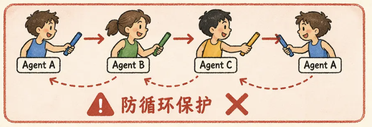

### 10.4 如何选择？

Single-Agent **架构简单、维护成本低、链路透明**，不要为了显得高级而引入 Multi-Agent。

**渐进式演进**：先用 Single-Agent 把系统跑起来。当发现某个环节确实成为瓶颈，比如 Context 经常撑满、某类子任务质量不行，再把那个环节拆出来，交给一个专门的 Worker Agent。

### 10.5 A2A（Agent-to-Agent）协议

解决**不同团队、不同框架开发的 Agent 之间怎么互相通信和协作**的问题。

### 10.6 怎么传递信息？

#### 10.6.1 消息传递

Agent 完成自己的工作后，把结果发送到一个**消息队列**。下游的 Agent 订阅自己感兴趣的消息，取到了再开始处理。

- **优点**：解耦。
- **缺点**：需要消息中间件来维护机制。

#### 10.6.2 共享状态

所有 Agent 都读写同一个**状态对象**。每个 Agent 执行完就往 `State` 里写入自己的结果，下一个 Agent 直接从 `State` 里读取前面的产出。

### 10.7 共享状态中的状态管理

#### 10.7.1 全局状态和局部状态

分成两层：

| 状态 | 存放内容 |
| :--- | :--- |
| **全局状态** | 所有 Agent 都需要读取的信息 |
| **局部状态** | 每个 Agent 自己的中间结果 |

#### 10.7.2 只追加，不覆盖

**每个 Agent 完成工作后把结果追加到状态里，而不是修改已有的字段。**

#### 10.7.3 错误状态的处理

**如果某个 Agent 执行失败了，它的错误信息也应该写入状态。**

## 11. Agent 框架

### 11.1 LangChain

**封装重复工作，不用每次造轮子。**

- 一个 `@tool` 装饰器就能注册工具。
- `AgentExecutor` 把整个 ReAct Loop 封装进去。
- 还内置了 Tracing、Callback、记忆管理。

**上手快、效率高。**

### 11.2 框架的使用与痛点

#### 11.2.1 探索期：POC（概念验证）

目标是把流程跑通。LangChain 省掉大量的样板代码，验证 Idea。

#### 11.2.2 Bug 调试

代码只有五十行，但报错的 Stack Trace 有四十层，往下追到了框架内部。

框架的抽象层太多，排查问题需要穿透那些你没写、也不完全懂的层。

#### 11.2.3 版本升级坑

某次依赖升级，LangChain 改了接口，要么回滚，要么把代码改到兼容新版本，可能涉及十几处修改。

#### 11.2.4 性能优化

框架内部在每次调用时做了你根本不需要的事：序列化中间结果、触发一堆 Callback、记录详细日志……

这些逻辑是框架为了通用性设计进去的，对你的具体场景没有用，但每次调用都在跑。

### 11.3 手搓：完全掌控

- **链路透明、可观测性好**。
- **精确裁剪、没有多余开销**，不用带任何通用性包袱。
- **稳定可控、不受框架升级影响**。

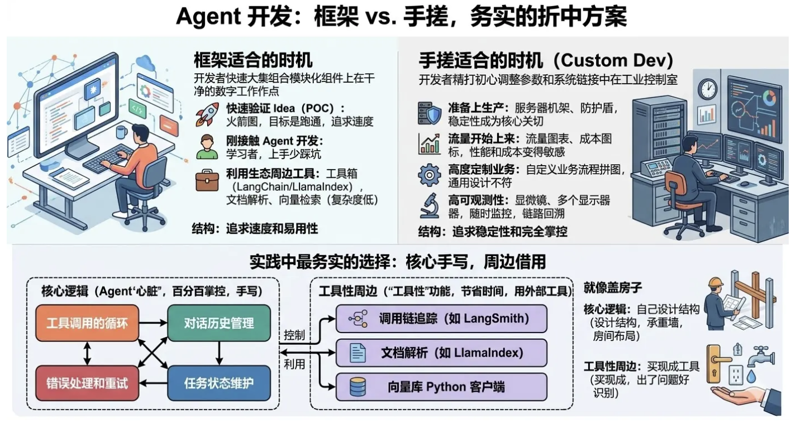

### 11.4 真实的演进轨迹

1. **先用框架快速跑通**，验证方向。
2. 遇到第一批线上问题后，把**排查困难的关键部分替换为手写**。
3. 流量上来后，把**性能敏感的核心逻辑全部手写**。
4. 最后，框架只保留**做得很好的周边工具**。

## 12. 反思机制

### 12.1 核心循环：生成 → 评估 → 改进

#### 12.1.1 第一个 Prompt：评估、找问题

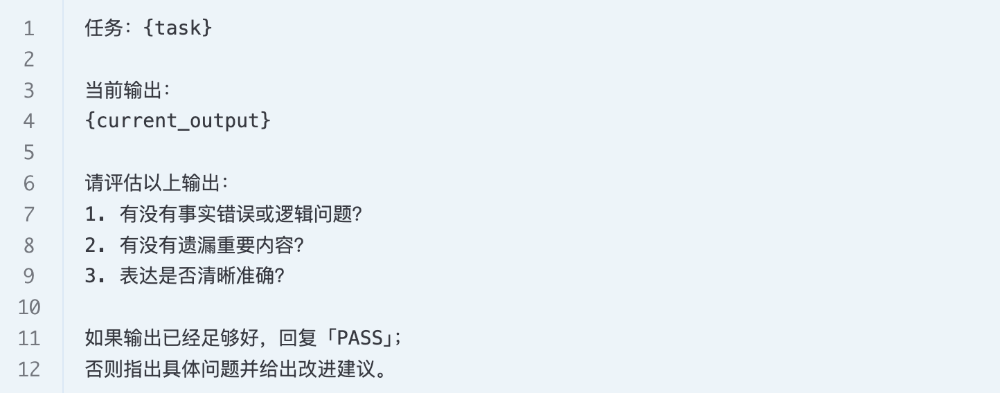

#### 12.1.2 第二个 Prompt：改进

传入**原始任务、原始输出、评估意见**。

两个 Prompt 循环调用，直到 LLM 自己回复 `PASS`。

> **不过，硬性的轮次上限是唯一可靠的退出机制，防止为了改而改。**

### 12.2 粒度

| 粒度 | 做法与特点 |
| :--- | :--- |
| **步骤级** | 每个工具调用或推理步骤完成后立即检查，早发现、早纠正 |
| **任务级** | 整个任务执行完之后做一次整体评估，开销更小，整个任务只多一次 LLM 调用；能发现步骤级看不到的问题，如整体结论前后矛盾，或者各部分之间衔接不自然 |

### 12.3 多 Agent 互评

专门设置一个独立的 **Critic Agent**，让它来审查执行 Agent 的输出。

因为对自己输出的错误不够敏感，容易陷入自洽，有一套自己的内部逻辑。

### 12.4 使用场景

> **输出质量要求高、错误代价大的关键节点。**

## 13. 上下文工程

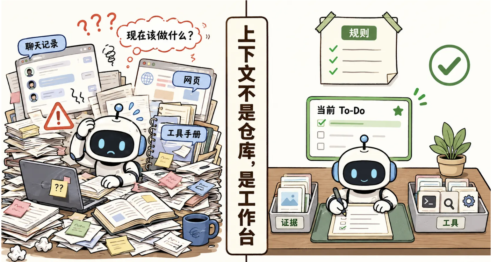

### 13.1 组成部分

#### 13.1.1 指令

| 指令 | 作用 |
| :--- | :--- |
| **System** | 规定 Agent 的身份、总体边界和安全规则 |
| **Developer** | 放应用侧的流程、业务约束和输出协议 |
| **User** | 表达用户这一次明确要完成的任务 |

#### 13.1.2 任务状态

明确记录**核心目标、成功标准、硬约束、当前步骤、待办项、已完成项、待确认问题和关键产物引用**。

#### 13.1.3 对话与 Memory

最近几轮对话保留当前语境，长期 Memory 提供跨会话的稳定信息。

#### 13.1.4 外部观察

包括工具定义、工具执行结果和 RAG 检索证据。

> **总结**：指令决定行为边界，任务状态决定执行位置，Memory 补充过去，RAG 和工具结果补充外部事实。

### 13.2 上下文装配

先判断**当前模型调用到底要完成哪个子任务**。

四个维度筛选：

- **与当前步骤的相关性**。
- **来源可信度**。
- **信息新鲜度**。
- **缺失后的风险**。

> **注意**：Top K 只能解决相关不相关，解决不了可信不可信。检索打分之后还要做来源过滤、去重和版本判断，涉及事实回答时还要保留证据来源。

### 13.3 上下文排序

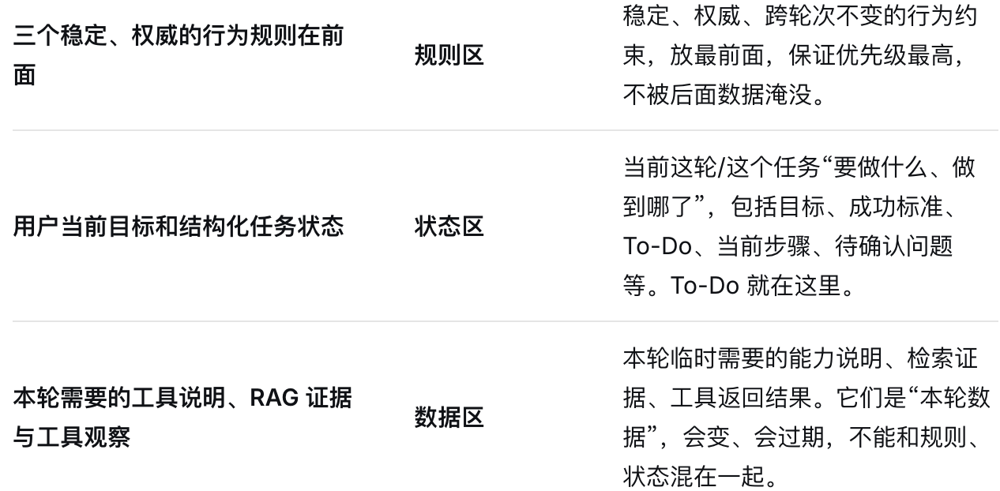

1. 稳定、权威的行为规则在前面。
2. 用户当前目标和结构化任务状态。
3. 本轮需要的工具说明、RAG 证据与工具观察。

**“规则、状态、数据”一定要分区。** 任务状态单独放，让模型拿到一张清晰的施工单。

### 13.4 To-Do 任务状态区

把散落在历史对话里的进度，变成模型每轮都能**读取和更新的显式状态**。

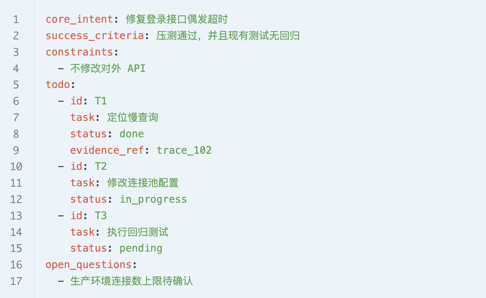

- **每一步执行前**：Agent 知道当前注意力该放在哪里。
- **执行后**：把结果、证据引用和状态变化写回去，下一轮再读取。

To-Do 不是生成一次就永远不动。如果用户新增需求，或者工具结果证明原计划走不通，Agent 要**重新评估依赖关系并更新计划**。

### 13.5 隔离

- **防止外部数据变成指令**：工程上要把指令区和数据区明确分开。
- 高风险工具在外部增加**参数校验、权限检查和人工确认**。

### 13.6 Token 预算

根据任务预留**输出 Token 和安全余量**，剩下的容量才分给输入。

输入预算可以按区域设上限，但**不要把比例写死**，预算器应当随任务阶段调整。

**超长时，按以下顺序降载：**

1. 去掉重复内容。
2. 移除低相关工具和证据。
3. 用结构化状态替代冗长过程。
4. 压缩较旧历史。

### 13.7 完整链路：运行时装配

1. **确定当前步骤**。
2. **读取最新指令和任务状态**。
3. **按需召回 Memory、RAG 与工具**。
4. **过滤冲突和低质量内容**。
5. **分配 Token 并分区渲染**。
6. **调用模型**。
7. **把状态变化和证据引用写回**。

## 14. 多轮对话状态管理

### 14.1 信息分四类记住

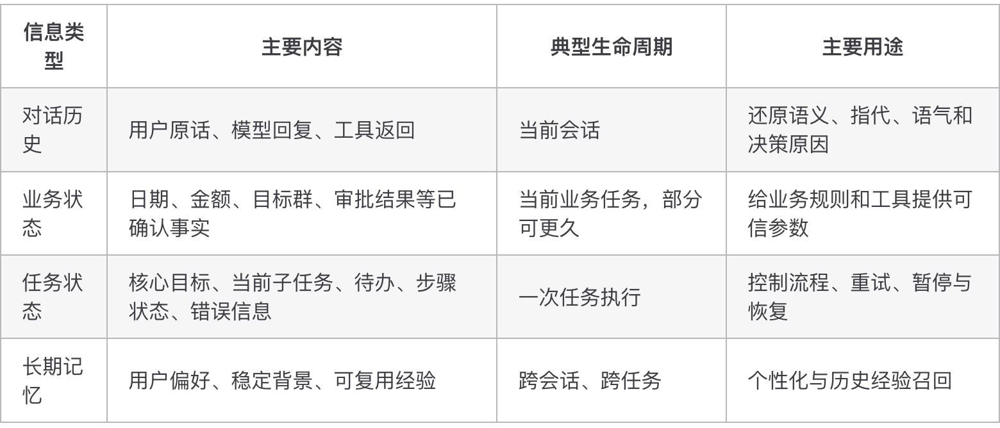

### 14.2 任务状态

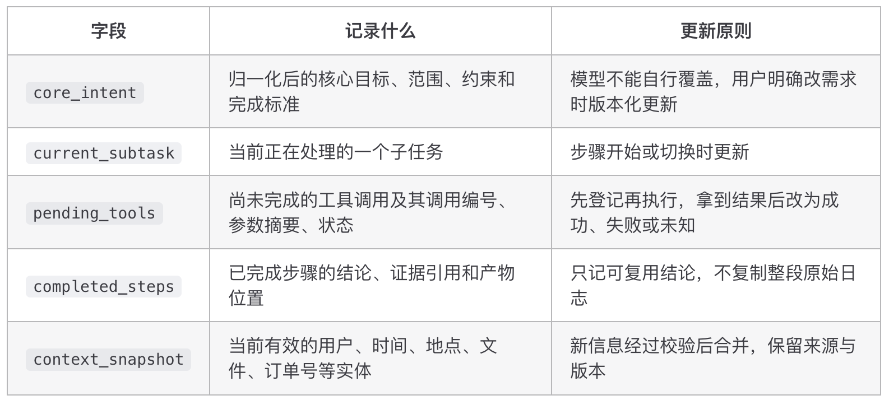

还有 `session_id`、`task_id`、`turn_id`、`state_version` 等字段：

- **`session_id` 或 `thread_id`**：标识一段连续交互。
- **`task_id`**：标识会话中的某个具体任务。
- **`state_version`**：用户连续发来两条补充消息，或者两个 Worker 同时处理同一任务时，可以用版本号做乐观锁或比较后更新，避免较晚写入的旧状态把新状态覆盖掉。

### 14.3 每新来一条消息

先判断它和当前任务是什么关系，把新输入分成四类：**补充、纠错、澄清回复和新任务**。

一旦确认是新任务，可以暂停旧 `task_id` 并创建新任务。用户后来要求继续时，再恢复旧任务的 Checkpoint。

### 14.4 状态机和自然语言历史

**两者合作：**

- **自然语言历史负责理解**：例如用户说“还是按上周那个风格来”，模型需要结合近几轮消息和检索到的相关记忆，才能明白“那个风格”指什么。
- **状态机负责执行**：例如任务当前处于 `WAITING_CONFIRMATION`，即使模型突然建议调用发送工具，执行器也应该拒绝，只有收到有效确认后才能进入 `EXECUTING`。

模型可以提出“更新哪些字段、下一步建议去哪里”，但输出必须经过 **Schema 校验、权限校验和状态转换校验**。

> **最终提交状态的是编排层，不是模型自己。**

### 14.5 意图锚点

1. **第一道防线：始终保留结构化的 `core_intent`。**
2. **第二道防线：做进度核对。** Checker 都要问两个问题：这个结果是否推进了核心目标？下一步是否仍来自未完成计划？
3. **第三道防线：保留事实来源和状态版本。** 工具结果出错时，不应该让后面的摘要把错误结论包装成确定事实。

### 14.6 中断

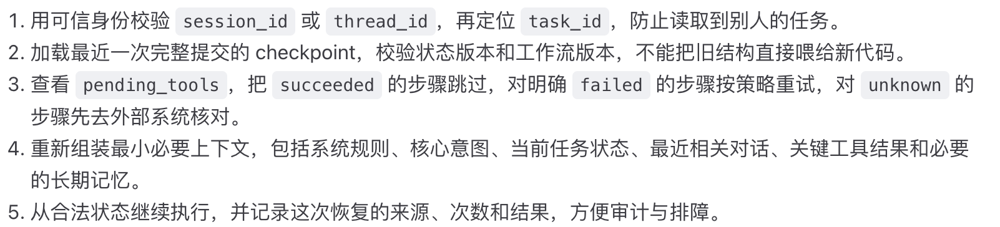

### 14.7 状态存储

- **活跃会话**：放在 Redis 之类的低延迟存储里。
- **关键 Checkpoint 和审计记录**：落到持久化数据库或对象存储。

## 15. Agent 评估

### 15.1 为什么不能只看最终答案？

**最终答案不能独自证明事情有没有做成、过程是否合规。**

### 15.2 四层评测

#### 15.2.1 工具是否可靠

检查该不该调用、工具选得对不对、参数和返回处理是否正确。

有副作用的工具还要测试**幂等性**。

#### 15.2.2 单步决策和完整轨迹是否合理

- **单步评测**：在某个固定状态下问“Agent 下一步该做什么？”
- **轨迹评测**：把整条工具调用序列拿出来看。

看每一步决策是否合理，有没有**漏步骤、重复调用、越权或绕过必要流程**。

#### 15.2.3 端到端任务是否真的完成

- 满足成功条件的任务数占全部评测任务的比例。
- **同题多跑，看稳定性。**

#### 15.2.4 线上业务是否得到改善

| 维度 | 指标 |
| :--- | :--- |
| **业务指标** | 真实业务里的成功率、用户接管率 |
| **工程指标** | 延迟、Token、成本 |
| **安全指标：单独看** | 安全事件，如未授权工具调用、敏感信息泄漏 |

### 15.3 评测集

#### 15.3.1 每条评测样本包含什么？

初始环境状态、用户目标、预期最终状态、可用工具、必须或禁止的动作、关键约束、评分规则，以及需要时提供的参考轨迹。

对于开放式结果，可以保存**评分 Rubric 和少量优质示例**。

#### 15.3.2 样本来源

| 来源 | 做法与示例 |
| :--- | :--- |
| **用户真实请求** | 按任务类型、难度、工具、对话轮数和风险等级分层采样 |
| **边界场景** | 参数缺失、时间表达含糊、工具超时、返回空结果、上下文很长 |
| **对抗与安全样本** | 工具返回中藏着提示词注入；用户要求越权读取数据；诱导 Agent 绕过确认流程 |
| **历史 Badcase** | 线上每出现一种新的失败模式，人工确认原因后，就把有代表性的样本加入回归集 |

评测集还要**按场景切片**。外部工具会变化，评测环境也要尽量**可复现**。

### 15.4 评分体系

#### 15.4.1 确定性检查：优先使用

参数能否通过 Schema、是否调用禁用工具、数据库最终状态是否正确、代码是否通过测试，这些都可以由程序直接判断。

**速度快、成本低、结果稳定。**

#### 15.4.2 人工评审：定义标准和处理高风险歧义

领域专家适合判断政策是否遵循、开放式结果是否有用，也适合审查自动裁判分歧大的样本。

人工不一定要评全部数据，更重要的是**建立清楚的 Rubric，并持续抽查自动评测是否跑偏**。

#### 15.4.3 LLM-as-a-Judge：扩展开放式评测

大模型裁判必须**用人工样本校准**，让大模型按 Rubric 输出**结构化分数和理由**。

有位置偏差、篇幅偏差和自我偏好等问题。

### 15.5 指标与持续回归

把**安全和关键业务约束设成发布硬门禁**，再根据业务目标比较任务完成率、轨迹质量、延迟和成本。

> **上线后通过 Trace、用户反馈和业务结果发现 Badcase，再回流到离线集，形成持续回归闭环。**
