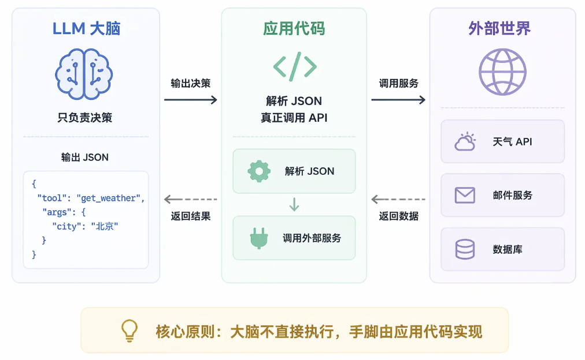
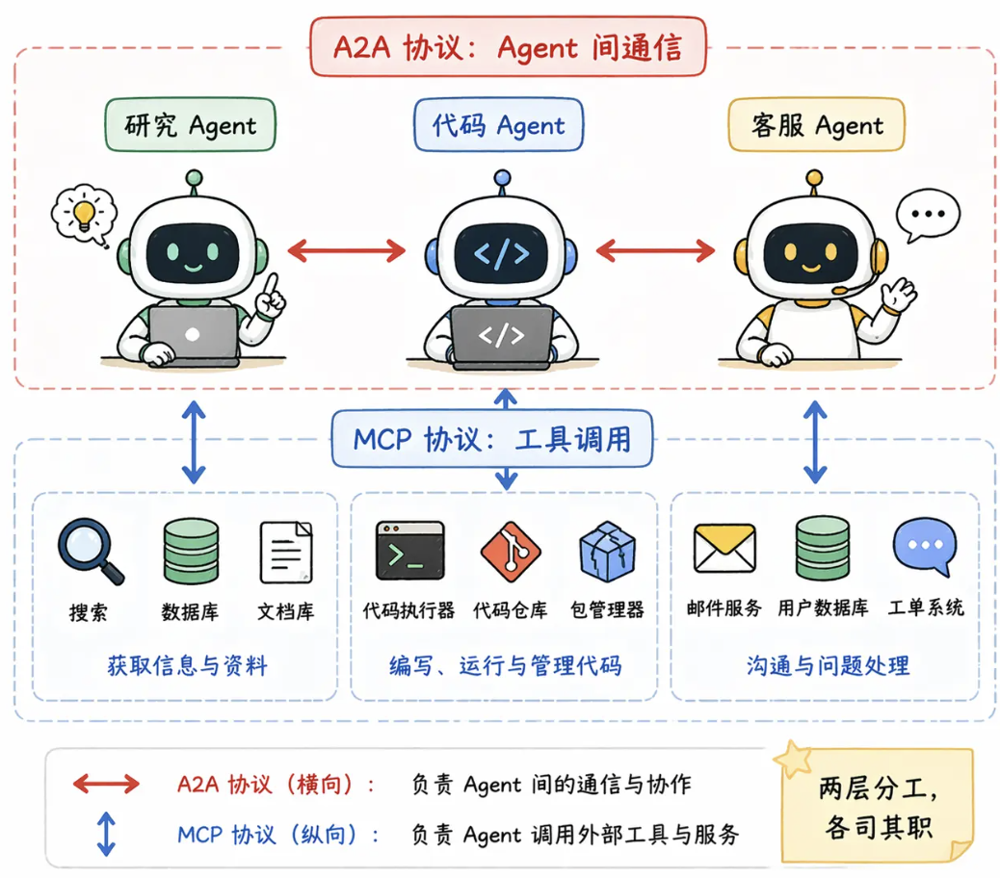

# Agent

## 1. 从普通大模型到 Agent

### 1.1 普通大模型的局限

- **知识被冻结**：模型的训练数据有截止时期，无法获取实时信息。
- **不能行动**：本质是文本生成器，无法执行任何行动。
- **没有持续状态**：每次调用之间是失忆的。

### 1.2 Agent 是什么？

**能自主完成目标的 AI 系统。**

运作闭环（与传统的核心区别）：**感知 → 规划 → 行动 → 再感知**。

### 1.3 三大核心能力

#### 1.3.1 工具调用

调用外部工具，比如搜索引擎、代码执行器、数据库、API。

> **注意**：模型不是自己执行，是模型告诉代码去执行，结果再反馈给模型。

#### 1.3.2 记忆机制

**短期记忆 + 长期记忆。**

| 类型 | 内容 |
| :--- | :--- |
| **短期记忆** | 当前任务执行过程中的中间状态 |
| **长期记忆** | 跨任务的信息，比如用户偏好、历史操作记录 |

长期记忆用向量数据库存储，需要的时候做语义检索拿回来。

#### 1.3.3 多步推理和自我纠错

执行过程中能**感知失败、分析原因、换一种方式重试**，还有边做边反思。

## 2. 为什么 Agent 现在才爆发？

### 2.1 大模型的能力提升

从 GPT-4、Claude 3 这一代开始，能读懂复杂指令并作出合理的多步决策了。

### 2.2 工具调用的标准化

OpenAI 推出了 **Function Calling** 机制，让模型能以结构化的 JSON 格式输出工具调用请求，有了统一的工具调用协议。

### 2.3 配套生态的完善

LangChain、LlamaIndex 这些框架把 Agent 的开发门槛大幅降低了。

## 3. 标准协议

### 3.1 MCP（模型上下文协议）

**Anthropic 提出，解决工具调用问题。**

定义一套标准的 **JSON-RPC 协议**，工具提供方只要按这个标准暴露自己的能力，任何支持 MCP 的 Agent 都能直接发现和调用这些工具，不用额外写适配代码。

### 3.2 A2A（Agent 间通信协议）

**解决 Agent 怎么和另一个 Agent 协作的问题。**

每个 Agent 都有一个名片，写明能做什么、正在做什么、需要什么输入。

