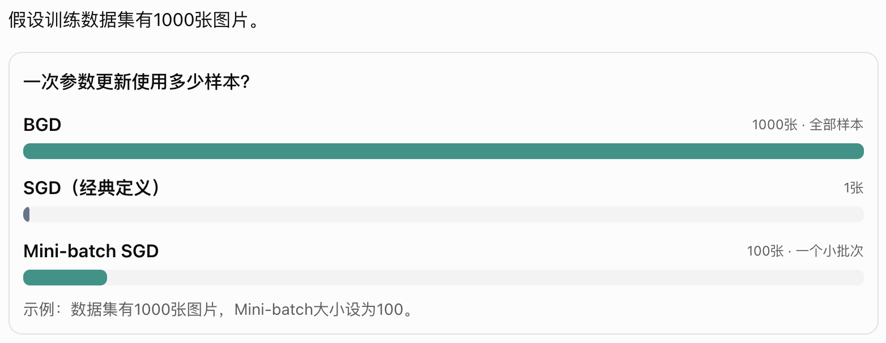
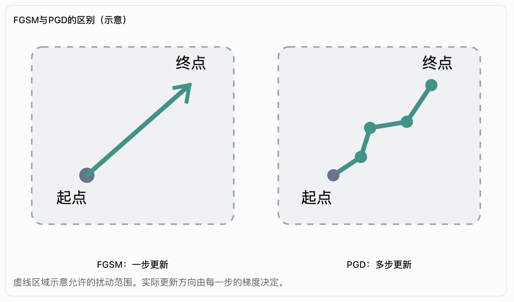

# Deep Learning

## 1. 损失函数

### 1.1 Cross Entropy（交叉熵损失）

$$
\mathrm{CE}(p_t) = -\ln(p_t)
$$

**局限性**：如果正负样本极度不平衡，大量容易分类的负样本仍可能累计产生较大的总损失贡献。

每个容易分类的负样本损失很小，但累积起来很大，导致忽略了不易分类的正样本的训练。

### 1.2 Weighted Cross Entropy（加权交叉熵）

在交叉熵前面加一个权重 $w$。

例如，正样本数量远少于负样本时，可以**提高正样本的损失权重**。

**局限性**：权重主要由类别决定，**不会根据每个样本的预测难度自动调整**。

### 1.3 Focal Loss（焦点损失）

最初针对目标检测中大量简单背景样本主导损失的问题。

> **核心思想**：降低容易分类样本的损失贡献，让模型更关注困难样本。

$$
\mathrm{FL}(p_t) = -\alpha_t \cdot (1-p_t)^\gamma \cdot \ln(p_t)
$$

$\gamma$：调制因子，控制容易样本损失被降低的程度。

#### 1.3.1 Alpha 与 Gamma 的区别

| 参数 | 作用 |
| :--- | :--- |
| **Alpha（α）** | 调整不同类别的损失权重 |
| **Gamma（γ）** | 根据样本难度动态调整损失贡献 |

#### 1.3.2 加权交叉熵与焦点损失对比

| 对比维度 | Weighted CE | Focal Loss |
| :--- | :--- | :--- |
| **主要解决** | 类别不平衡 | 容易样本主导损失 |
| **权重依据** | 真实类别 | 类别 + 预测难度 |

#### 1.3.3 举例理解

假设班里有 1,000 道题：

- **100 道数学题**（少数类）。
- **900 道语文题**（多数类）。

老师发现，训练时语文题数量太多，数学题得不到足够重视。

| 方法 | 理解 |
| :--- | :--- |
| **Weighted CE** | 按科目分配重要性 |
| **Focal Loss** | 重点关注不会的题 |

### 1.4 Huber Loss

**小误差使用平方损失，大误差使用线性损失**，不容易受到极端误差影响。

### 1.5 Dice Loss

主要用于**图像分割**，衡量预测区域与真实区域的重叠程度，减少单纯依靠整体像素准确率带来的问题，适合关注面积较小的前景目标。

$$
\mathrm{Dice} = \frac{2|A \cap B|}{|A| + |B|}
$$

---

## 2. 正则化（缓解过拟合）

### 2.1 Dropout

**训练时随机让一部分神经元暂时休息**，减少神经元之间的**协同适应**，学习在不同神经元组合下仍然有用的特征。

**没有额外的可训练权重。**

#### 2.1.1 反向 Dropout（Inverted Dropout）

PyTorch 默认采用的方法。

| 阶段 | 做法 |
| :--- | :--- |
| **训练时** | 随机丢弃部分元素，并将保留下来的元素除以保持概率 |
| **推理时** | 关闭随机丢弃，直接使用完整激活 |

##### 2.1.1.1 为什么训练时要除以保持概率？

**让激活值的期望保持不变。**

原始神经元输出：

$$
x = 10
$$

Dropout 丢弃概率：

$$
p_{\text{drop}} = 0.2
$$

训练时：

| 情况 | 概率 | 缩放后的输出 |
| :--- | :--- | :--- |
| **被丢弃** | 20% | 0 |
| **被保留** | 80% | $10 / 0.8 = 12.5$ |

因此，训练输出的期望为：

$$
E[y] = 0.2 \times 0 + 0.8 \times 12.5 = 10
$$

刚好等于原始输出。

---

## 3. 梯度下降

### 3.1 BGD、SGD、Mini-batch SGD

**主要区别：每次计算梯度时使用多少训练样本。**



| 方法 | 名称 | 特点 |
| :--- | :--- | :--- |
| **BGD** | 批量梯度下降 | 梯度更稳定；但每次更新需要处理所有样本，数据量大时计算成本和内存需求都可能很高 |
| **SGD** | 随机梯度下降 | 单次更新计算成本较低、更新频繁；但单个样本估计出的梯度噪声较大，优化过程可能出现较明显的波动 |
| **Mini-batch SGD（MSGD）** | 小批量随机梯度下降 | 两者的折中，现代深度学习非常常用 |

### 3.2 AdaGrad（自适应梯度算法）

- **解决的问题**：自适应调整不同参数的有效学习率。
- **方法**：先累积历史梯度平方，再自动调整更新幅度。
- **局限性**：历史平方梯度持续累积，导致有效学习率可能逐渐变得过小。

---

## 4. 对抗机器学习

### 4.1 对抗样本

在正常输入上添加**经过特殊设计的微小扰动**，使模型产生错误预测的样本。

$$
\boxed{x_{\mathrm{adv}} = x + \delta}
$$

- $x$：原始输入。
- $\delta$：对抗扰动。
- $x_{\mathrm{adv}}$：对抗样本。

### 4.2 白盒攻击

已知模型结构和权重，能**直接获取真实梯度**，知道怎样修改输入会增大模型的损失。

#### 4.2.1 FGSM（快速梯度符号法）

沿着使模型损失增大的梯度方向，对输入添加扰动，使用的是 **Loss 对输入的梯度**。

#### 4.2.2 JSMA（基于 Jacobian 显著性图的攻击）

分析输入特征的变化对模型各类别输出的影响，优先修改对目标分类结果影响较大的特征。

根据模型第 $j$ 个输出对第 $i$ 个输入特征的敏感程度，选择相应特征进行修改。

#### 4.2.3 PGD（投影梯度下降法）

反复沿着**增大模型损失的方向**修改输入，并保证扰动始终在允许范围内。



### 4.3 黑盒攻击

只能提交输入、观察输出，再根据反馈推测如何修改输入。

> 不意味着完全无法利用梯度信息，而是**不能直接获取目标模型的真实梯度**。

#### 4.3.1 梯度估计攻击：ZOO

```text
输入 x
  │
  ├── 稍微增加第 i 个输入值 → 观察模型输出
  │
  └── 稍微减少第 i 个输入值 → 观察模型输出
                                  │
                                  ▼
                          比较两次输出变化
                                  │
                                  ▼
                              估计梯度
```

#### 4.3.2 Genetic Algorithm（遗传算法）

```text
生成多个候选扰动
        │
        ▼
提交模型，观察攻击效果
        │
        ▼
选择效果较好的候选扰动
        │
        ▼
    交叉与变异
        │
        ▼
  生成下一代扰动
        │
        ▼
     重复搜索
```

#### 4.3.3 Transfer-based Attack（迁移攻击）

利用替代模型生成的对抗样本，测试其是否也能影响目标模型。

| 模型 | 可访问信息 |
| :--- | :--- |
| **替代模型** | 攻击者可以访问其结构、参数和梯度 |
| **目标模型** | 无法直接获取内部梯度 |

> **使用 FGSM 攻击替代模型，并不意味着直接对黑盒目标模型执行了标准白盒 FGSM。**
