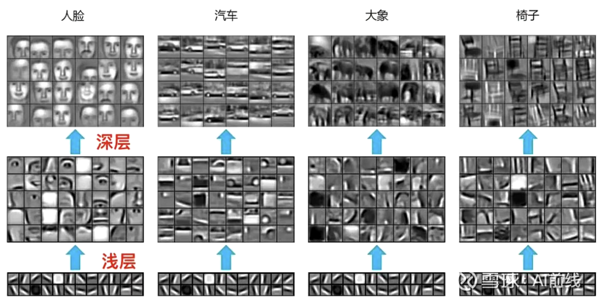

# 预训练

## 1. 图像模型预训练

### 1.1 预训练有什么用

#### 1.1.1 项目特点

- **深度学习（人工智能）**：大数据支持（主流）。
- **机器学习**：偏数学统计。
- 我们很多项目没有大数据支持（小数据）。

#### 1.1.2 任务 B：猫狗分类

- **数据**：100 张猫和狗的图片。
- **任务**：给一张图片，分出是猫还是狗。
- **问题**：无法解决的一个问题，精度很低。

#### 1.1.3 任务 A：鹅鸭分类

- **数据**：100,000 张鹅和鸭的图片。
- **已有模型**：已知，有人做过，做了一个模型 A，100 层 CNN。

#### 1.1.4 使用 A 完成 B

有人发现**浅层是通用的（横、竖、撇、捺）**，尝试使用 **A 的前 50 层**去完成任务 B。

### 1.2 方法

| 方法 | 浅层参数 |
| :--- | :--- |
| **冻结** | 浅层参数不变 |
| **微调** | 浅层参数会跟着任务 B 训练而改变 |

### 1.3 预训练是什么

通过一个已经训练好的模型 A，去完成一个小数据量的任务 B（使用了 A 的浅层参数）。

> **前提**：两个任务是极其相似的。

---

## 2. 大语言模型预训练

### 2.1 训练方式

使用**大规模文本数据**，通过**预测下一个 Token** 的方式训练模型。

### 2.2 预训练的作用

| 作用 | 形象的简短例子 |
| :--- | :--- |
| **学习通用表示** | 像学会辨认词义：“苹果很甜”与“苹果发布手机”中的“苹果”，含义不同。 |
| **学习知识** | 像读书积累常识：学到“巴黎是法国的首都”。 |
| **基础生成能力** | 像学会接着写：看到“从前有一座山”，能续写故事。 |
| **提供可复用的模型参数** | 像已有底子的学徒：在预训练参数基础上继续训练，适应客服问答任务。 |

### 2.3 预训练流程

> **数据**（清洗、过滤、去重、配比）→ **Token** → **预测** → **损失** → **参数更新**

**Tokenizer**：文本转换成模型能够处理的 Token ID 序列。
