# PyTorch

## 1. Tensors

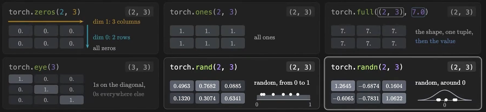

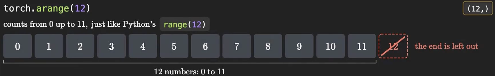

## 2. Tensor operations

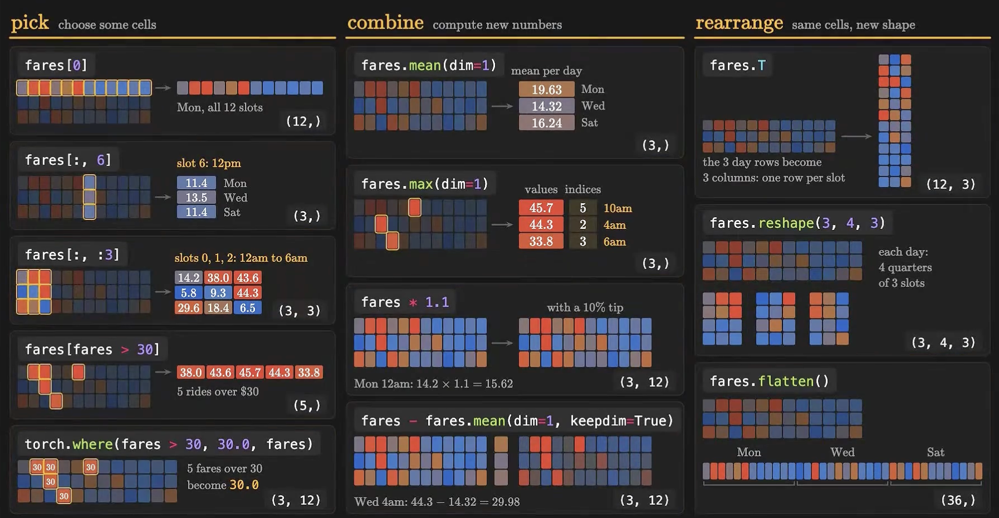

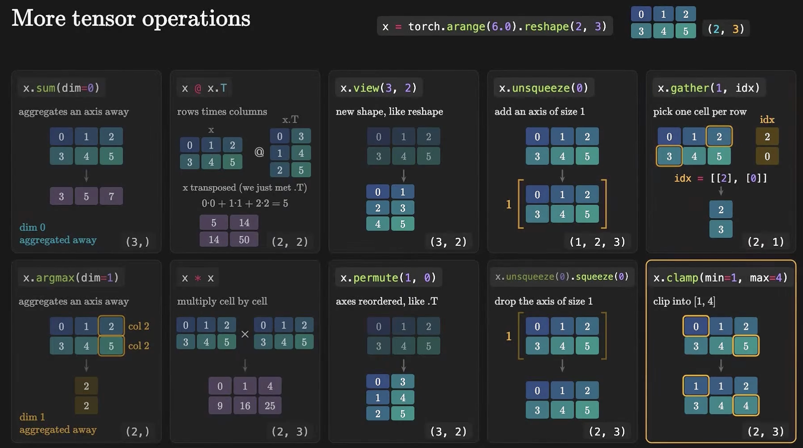

> **注释**：聚合操作中，传入的 `dim` 是被聚合的维度。

## 3. Predict

```python
pred = w * m + b
```

## 4. 损失函数

```python
loss = ((pred - f) ** 2).mean()
```

**平方，否则误差会正负抵消。**

## 5. 梯度下降

```python
err = pred - f

dw = 2 * (err * m).mean()
db = 2 * err.mean()
```

有了梯度方向，要走多远呢？

```python
w, b = w - lr * dw, b - lr * db
```

## 6. 自动求取梯度：Autograd

### 6.1 核心：requires_grad=True

持续记录这些参数参与的计算，沿记录反向遍历以填充 `grad`。

```python
w = torch.tensor(1.0, requires_grad=True)
b = torch.tensor(0.0, requires_grad=True)
```

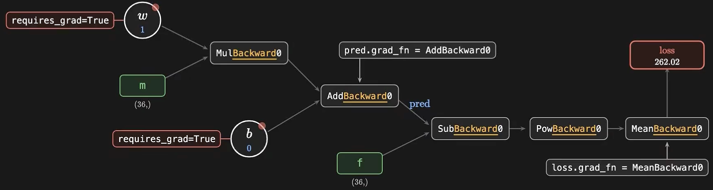

会记住生成当前值的计算节点及其名称。

```python
loss.backward()
```

PyTorch 会顺着计算图往回推，算出 `loss` 对 `w` 和 `b` 的导数（梯度），把梯度值填进 `w.grad` 和 `b.grad` 里。

### 6.2 特殊情况一：梯度累加

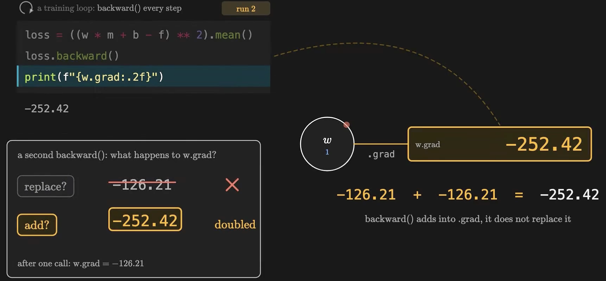

**`backward()` 是累加，不是替代。** 完成更新后，需要手动清零：

```python
w.grad, b.grad = None, None
```

### 6.3 特殊情况二：参数更新不记录到计算图

直接执行下面的更新会报错：

```python
w -= lr * w.grad
```

在 Autograd 记录开启时，不允许直接原地修改一个需要求导的叶子节点的值，因为这会破坏计算图的历史记录，影响反向传播。

**解决方法：**

```python
with torch.no_grad():  # 告诉 PyTorch：接下来的操作别记录到计算图里
    w -= lr * w.grad
    b -= lr * b.grad
```

此时没有产生新的计算节点。虽然值变了，但它们依然是**需要求导的叶子节点**，留待下一次前向传播继续使用。

| 操作 | 是否需要记录 |
| :--- | :--- |
| **模型的数学计算**，比如算 Loss | 需要记录 |
| **参数更新**，如 `w -= lr * w.grad` | 不需要记录 |

### 6.4 手动求导与 Autograd 对比

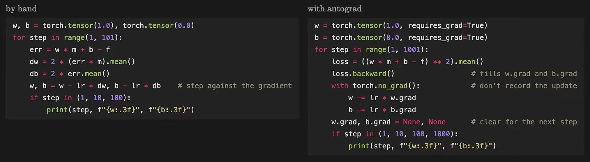

## 7. Loop

### 7.1 使用 torch.optim 更新

```python
opt = torch.optim.SGD([w, b], lr=lr)
```

| 优化器操作 | 替代的手动操作 |
| :--- | :--- |
| `opt.step()` | 在 `torch.no_grad()` 下更新 `w`、`b` |
| `opt.zero_grad()` | `w.grad, b.grad = None, None` |

```python
opt.step()
opt.zero_grad()
```

### 7.2 使用 nn.Module 管理模型参数

现实中模型可能包含数百万个权重，如何全部交给优化器呢？

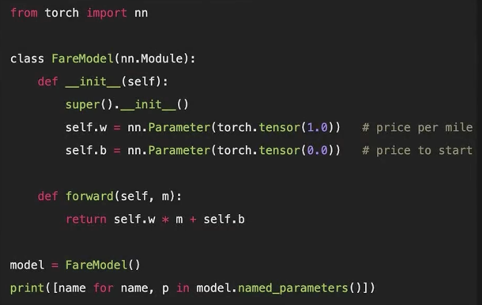

- **`nn.Module`**：模型基类。
- **`nn.Parameter`**：替换 `torch.tensor(1.0, requires_grad=True)` 的写法，默认带有 `requires_grad=True`，并让模型能够找出注册的权重。

```python
from torch import nn


class FareModel(nn.Module):
    def __init__(self):
        super().__init__()
        self.w = nn.Parameter(torch.tensor(1.0))
        self.b = nn.Parameter(torch.tensor(0.0))

    def forward(self, m):
        return self.w * m + self.b


model = FareModel()
opt = torch.optim.SGD(model.parameters(), lr=0.01)
```

### 7.3 更复杂的情况：两层模型

```python
# 第一层：输入 1 个数，输出 4 个数
self.first = nn.Linear(1, 4)

# 第二层：输入 4 个数，输出 1 个数
self.second = nn.Linear(4, 1)
```

`model.parameters()` 收集的参数共包含 **4 + 4 + 4 + 1 = 13 个数值**。

### 7.4 内置损失函数与五行训练循环

```python
loss_fn = nn.MSELoss()
loss = loss_fn(pred, f)
```

```python
for step in range(1000):
    pred = model(m)
    loss = loss_fn(pred, f)
    loss.backward()
    opt.step()
    opt.zero_grad()
```

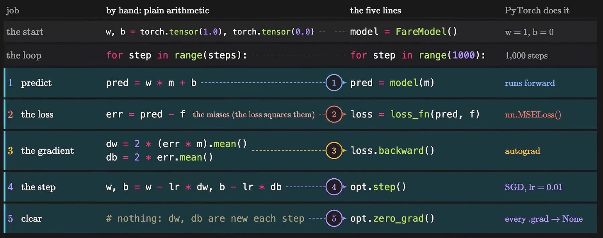

### 7.5 保存与加载模型

```python
torch.save(model.state_dict(), "fare_model.pt")

copy = FareModel()
copy.load_state_dict(torch.load("fare_model.pt"))
print(copy.state_dict())
```

### 7.6 Epochs 与 Batch

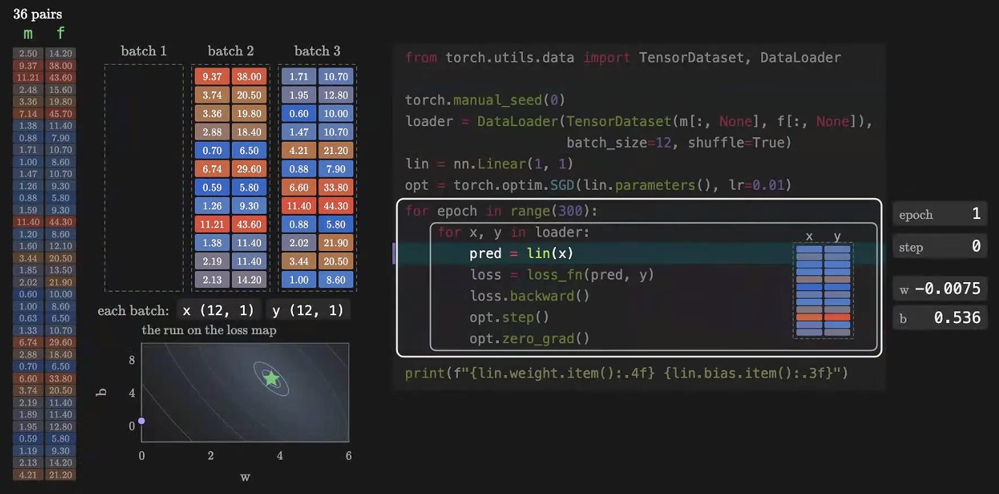

- **Batch（批次）**：五行代码每个批次运行一次。
- **Epoch**：遍历完全部 3 个批次，称为一个 epoch。
- 由每 **36 个数据**更新一次参数，变为每 **12 个数据**更新一次参数；每个 epoch 更新 **3 次**。若保持总更新次数不变，外层循环次数相应除以 **3**。

## 8. What else can we choose?

可以替换三个部分：**模型、优化器、损失函数**。

### 8.1 优化器

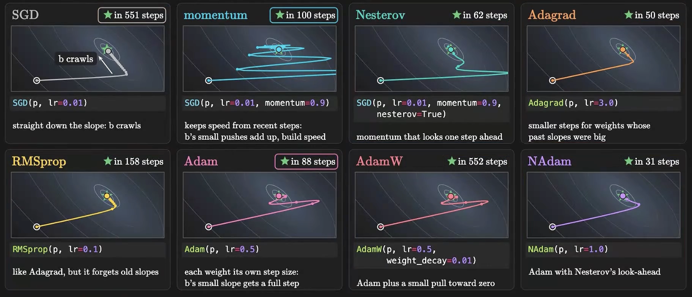

大概了解：在这个例子中，`b` 的梯度计算没有 `m` 这个乘数，相当于乘数为 1，所以相较于 `w` 更新更缓慢；不同的优化器可改善这点。

### 8.2 模型：两层之间加入激活函数

```python
model = nn.Sequential(
    nn.Linear(1, 16),
    nn.ReLU(),
    nn.Linear(16, 3),
)
```

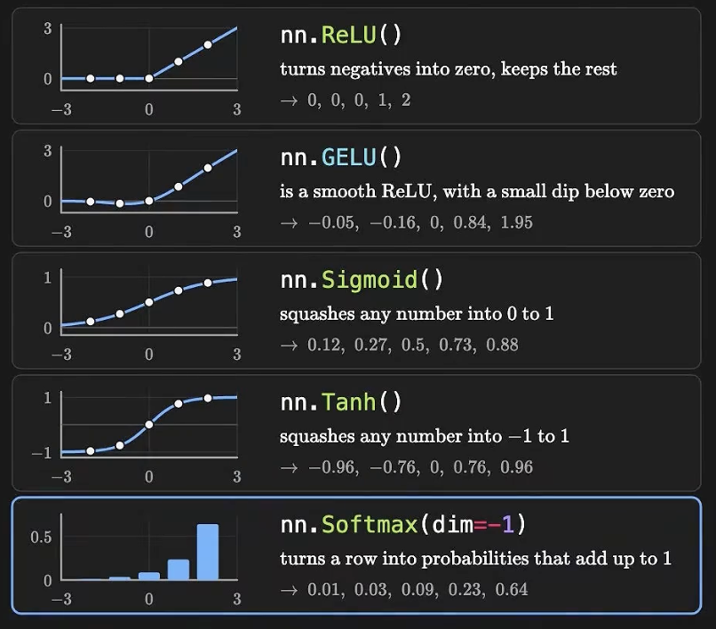

### 8.3 损失函数

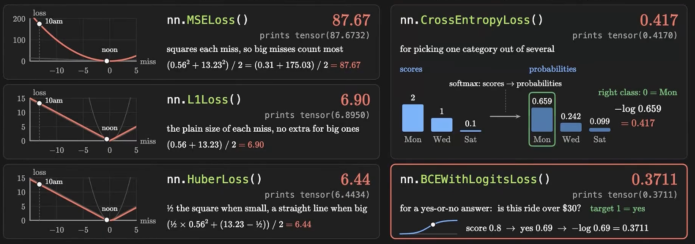
