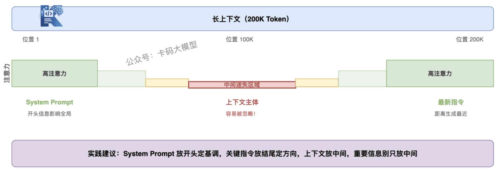
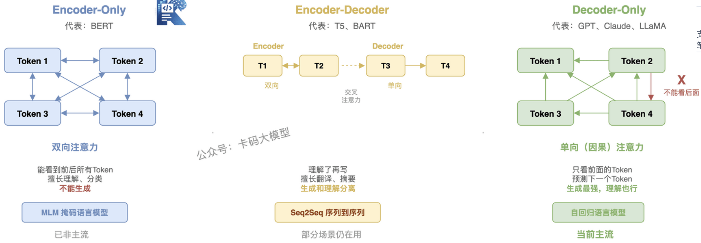
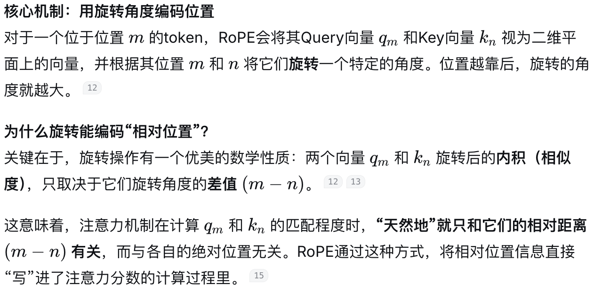

# Transformer

## 1. Transformer 之前

### 1.1 RNN（循环神经网络）的致命问题

- **梯度消失**：序列越长，前面的信息梯度信号传到后面就越弱，记不住长距离依赖。
- **串行计算**：一个 Token 一个 Token 地处理，没法并行，训练速度上不去。

### 1.2 CNN（卷积神经网络）的问题

- **局部感受野**：只能看到局部窗口内的信息，想看全局就得堆很多层，堆层数又带来训练难度。
- **长距离依赖弱**：两个相隔很远的词之间的关系，CNN 很难捕捉到。

## 2. Transformer 的解法：注意力机制

### 2.1 解决两个问题

- **不需要逐步传递信息**：第 1 个 Token 和第 1,000 个 Token 的关系，一步就能算出来。
- **并行计算**。

### 2.2 有替代方案吗？

| 方案 | 特点 |
| :--- | :--- |
| **Mamba** | 推理速度快，长距离有优势，但生成质量和通用性比不上 Transformer |
| **RWKV** | 结合了 RNN 和 Transformer 的优点，但生态不成熟 |
| **混合架构** | 部分层用 Transformer，还在探索 |

> **面试一句话**：Transformer 在全局建模和并行计算之间找到了最好的平衡，目前还没有架构能在通用性和性能上同时超越它。

## 3. Transformer 的灵魂：Self-Attention

### 3.1 核心思路

让每个词去看它和其他所有词的关系，然后根据关系远近决定关注多少，来**动态调整当前词的表示**。

**词的意思不是固定的，是由上下文决定的。**

### 3.2 Q、K、V 是什么？

Self-Attention 用三个矩阵把每个 Token 映射成三个向量：

| 向量 | 名称 | 含义 |
| :--- | :--- | :--- |
| **Q** | Query | 当前词想知道自己和谁有关系 |
| **K** | Key | 每个词能提供多少信息，来判断匹不匹配 |
| **V** | Value | 每个词的实际信息 |

> **Q 找对象 → K 判断匹配 → V 提供内容 → 加权求和更新表示。**

### 3.3 对应用开发的启示

**上下文质量决定注意力分配，注意力分配决定输出质量。** 所以我特别重视 Prompt 的结构化和上下文的精准性。

## 4. Multi-Head Attention

### 4.1 一个头的局限

单头注意力只有一个 QKV 变换，只能学一种关系模式，但语言中的关系多样（语法关系、指代关系、语义关系等）。

### 4.2 多头的解法

把 QKV 复制多份，**每份独立算注意力，每份学不同的关系模式**。

举例：

- 第 1 个头关注语法结构。
- 第 2 个头关注指代关系。
- 第 3 个头关注语义相近的词。
- 第 4 个头关注位置相邻的词。
- ……

### 4.3 对应用开发的启示

**Prompt 结构化**：多头注意力在处理结构化信息时效率更高，每个注意力头可以快速定位到自己关注的部分，不然需要额外的计算来提取结构。

## 5. Positional Encoding

**Self-Attention 不看顺序。**

### 5.1 怎么加的？

早期用正余弦编码位置，现在多用可学习的位置编码。

### 5.2 对应用开发的启示

#### 5.2.1 上下文限制

模型在训练时见过的位置范围是有限的。

如果一个模型训练时最长只见过 4,096 个 Token 的文本，那它对第 5,000 个位置的位置编码就没有学过。

#### 5.2.2 中间迷失问题

**重要信息要放在 Prompt 开头或结尾**：开头的内容对整个生成过程都有影响，最后的 Token 离生成位置最近。

## 6. Encoder-Only、Encoder-Decoder、Decoder-Only 三大架构

### 6.1 架构对比

| 维度 | Encoder-Only | Encoder-Decoder | Decoder-Only |
| :--- | :--- | :--- | :--- |
| **代表模型** | BERT | T5、BART | GPT、Claude、LLaMA |
| **注意力方式** | 双向注意力 | Encoder 双向 + Decoder 单向 | 单向注意力（因果注意力） |
| **能看到什么** | 整个输入 | Encoder 看全部，Decoder 只看前面 | 只看前面的 Token |
| **擅长什么** | 理解、分类、抽取 | 翻译、摘要、转换（输入和输出明确分离的任务） | 生成、对话、推理 |
| **生成能力** | 弱 | 强 | 最强 |

**大模型的行为（对话、代码、问答）本质上都是续写。**

### 6.2 为什么现在大模型都用 Decoder-Only？

1. **Scaling 效果最好**：同样的参数量和数据量，它在扩大规模时收益最大，因为它架构更简单统一，规模越大优势越明显，比如 GPT 系列。
2. **生成和理解都能做**：虽然是生成式的，但通过 Prompt 设计也能做理解任务。
3. **训练更高效**：每个位置的预测目标都是下一个 Token，训练目标统一；Encoder-Decoder 需要协调理解和生成两个训练。

## 7. Transformer 的局限性

### 7.1 O(n²) 计算复杂度

Token 越多，计算量平方级增长。

### 7.2 位置编码的外推问题

模型对训练时没见过的位置编码不可靠。

**缓解方案：**

- **RoPE（旋转位置编码）**：相对距离模式在训练中见过，模型就更容易复用。

- **滑动窗口注意力**：每个 Token 只在局部窗口内做注意力，序列再长，单个 Token 需要处理的最大相对距离也被限制在窗口内。

### 7.3 中间迷失

### 7.4 生成串行

Decoder-Only 模型生成 Token 是一个一个来的，第 N 个 Token 必须等前 N−1 个 Token 生成完。

> **并行的是计算，串行的是生成顺序。**
