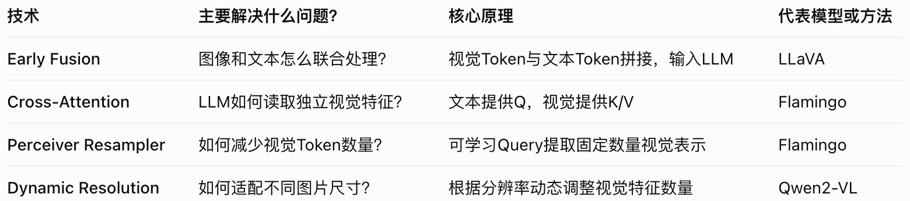

# 多模态模型

## 1. 核心问题

**图像 / 视频如何变成语言模型能处理的 Token，并和文本 Token 在同一个上下文中交互？**

VLM 通常先用**视觉编码器**把图像 / 视频转成 Visual Tokens，再通过**投影层**对齐到 LLM Hidden Space，最后和文本 Token 一起送入 Transformer。

## 2. Visual Tokens

### 2.1 图像

图像通常被切成 Patch：

> **Image → Patches → Vision Encoder → Visual Embeddings**

### 2.2 视频

视频需要同时处理：

- **空间维度**。
- **时间维度**：时序位置编码、时间戳、跨帧 Attention。
- **帧采样**：固定 FPS 采样、关键帧采样。
- **长视频 Token Budget**。

视觉 Token 太多会占用上下文窗口，因此需要**压缩、采样或动态分辨率**策略。

> **动态分辨率**：不强制所有图片使用完全相同的输入尺寸。

## 3. 模态对齐：Projector

**对齐目标：**

- 维度对齐。
- 语义空间对齐。
- 位置编码兼容。

## 4. 多模态位置编码：M-RoPE

### 4.1 不同模态的位置结构

- **文本**：一维顺序。
- **图像**：二维空间。
- **视频**：三维时空。

### 4.2 核心思想

$$
\boxed{\text{Position ID} = (t,h,w)}
$$

将 RoPE 的不同旋转维度分配给**时间、高度、宽度**三个位置分量。

### 4.3 不同模态的位置 ID

| 模态 | 编码方式 |
| :--- | :--- |
| **文本** | $(i,i,i)$ |
| **图像** | $(t_0,h,w)$，时间不变 |
| **视频** | $(t_f,h,w)$，时间随帧变化 |

### 4.4 与普通 RoPE 的关系

普通 RoPE：**根据 Token 的位置编号，对 Attention 中的 Query 和 Key 进行位置相关的旋转。**

M-RoPE 则进一步将旋转维度分配给：

- **时间 T**。
- **高度 H**。
- **宽度 W**。

## 5. 融合方式

| 方法 | 做法 |
| :--- | :--- |
| **Early Fusion** | Visual Tokens 和 Text Tokens 一起输入 LLM |
| **Cross-Attention** | LLM 通过 Cross-Attention 读取视觉 Memory |
| **Perceiver Resampler** | 使用固定数量的可学习 Latent Query，通过 Attention 读取视觉信息，把视觉 Token 压缩成固定数量 |
| **Dynamic Resolution** | 根据图像尺寸动态分配 Visual Token |

